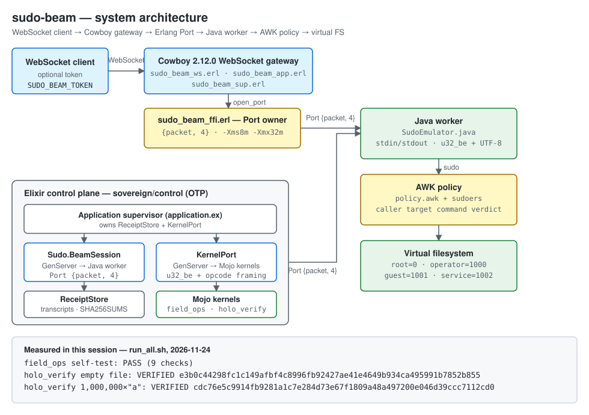
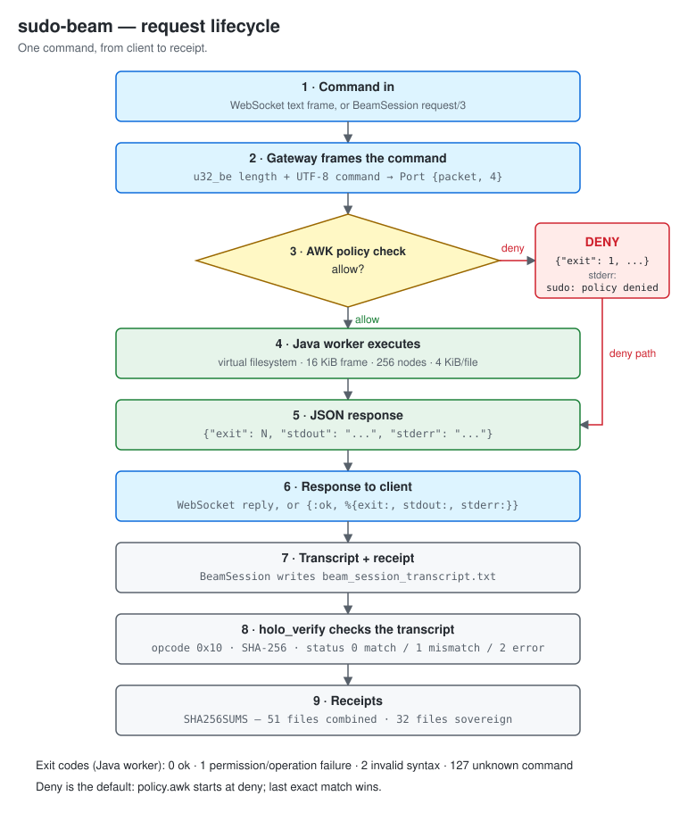
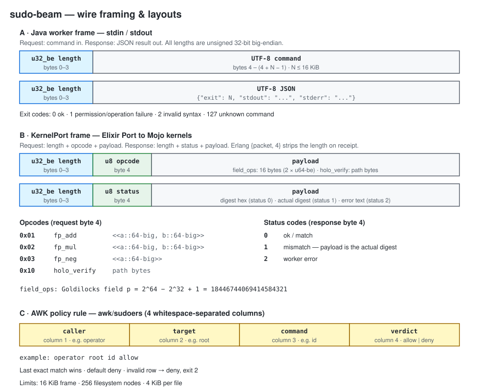
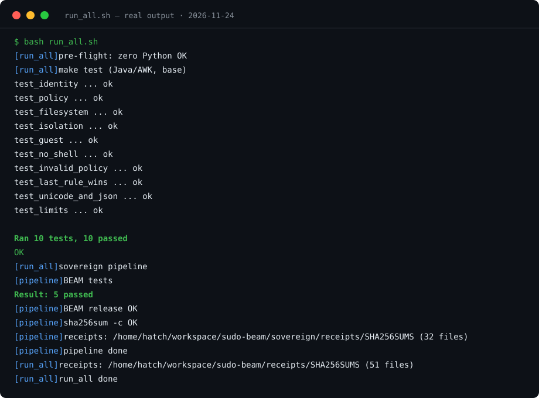

# SUDO-BEAM

[](https://github.com/AHMADALIPARR/sudo-beam/actions/workflows/ci.yml)
[](https://github.com/AHMADALIPARR/sudo-beam)
[](https://github.com/AHMADALIPARR/sudo-beam)
[](https://github.com/AHMADALIPARR/sudo-beam)
[](https://github.com/AHMADALIPARR/sudo-beam)
[](https://github.com/AHMADALIPARR/sudo-beam)

A virtual `sudo` command processor written in Java with AWK authorization and an Erlang/OTP WebSocket gateway. A BEAM port provides the foreign-process interface: each WebSocket session owns a JVM worker and its own virtual filesystem. No host sudo, setuid binary, host shell, or JNI library is involved.

# 1. System Architecture & Execution Pipeline

## 1.1 Audit basis

| Field | Value |
|---|---|
| Repository | `AHMADALIPARR/sudo-beam`, private, branch `main` |
| Tree audited | `/home/hatch/workspace/sudo-beam` |
| Audit date | 2026-11-24 |
| Tracked source files | 59 |
| Total source lines (`wc -l`) | 5408 |
| Build outputs audited | none; `build/`, `sovereign/control/_build`, `sovereign/control/priv`, `.mojo_cache` excluded |
| Local git repository | none in this tree; history exists only on the remote |
| Host OS | Ubuntu 24.04.5 LTS, x86_64 |
| Host CPU | 4 CPUs |
| Host RAM | 7934 MB |
| OpenJDK | 21.0.13.1 (javac 21.0.13.1) |
| Mojo | 1.2.0 (2016d0cd) |
| Erlang/OTP | 29 (erts-17.1.1) |
| Elixir | 1.20.5 (compiled with Erlang/OTP 29) |
| AWK | mawk 1.3.4 20240123 |
| Docker | not installed on audit host |
| rebar3 | not installed on audit host |
| Scripting interpreters in tree | 0 |

## 1.2 Component map



| Component | Runtime | Location | Role |
|---|---|---|---|
| Virtual sudo worker | Java 17+ (JDK 21 used) | `java/src/SudoEmulator.java` | Command parsing, virtual identities, virtual filesystem, policy dispatch |
| Policy evaluator | POSIX AWK (mawk) | `awk/policy.awk`, `awk/sudoers` | Caller/target/command authorization, last-match-wins |
| WebSocket gateway | Erlang/OTP, Cowboy 2.12.0 | `beam/src/` | Bearer-token HTTP upgrade, one JVM worker per WebSocket session |
| Control plane | Elixir 1.20 / OTP 29 | `sovereign/control/` | Supervision tree, Mojo worker Ports, receipt store, Sudo Platform stubs |
| Compute kernels | Mojo 1.2 | `sovereign/kernels/` | Goldilocks field arithmetic, pure-Mojo SHA-256 verification |
| Java worker bridge | Elixir 1.20 / OTP 29 | `sovereign/control/lib/sudo/beam_session.ex` | Elixir GenServer driving the Java worker over a Port |
| Test harness | Java (JDK stdlib only) | `tests/SudoEmulatorTest.java` | 10 framed-IPC tests against the Java worker |
| WebSocket smoke | Java (JDK stdlib only) | `tests/WsSmoke.java` | Live gateway smoke test |
| Kernel tests | Elixir ExUnit, OTP stdlib | `sovereign/control/test/` | SHA-256 vectors, framing round-trip, field edge cases |
| Packaging | Docker Compose | `Dockerfile`, `compose.yaml` | Non-root worker container, loopback port 8080 |
| Orchestration | POSIX Bash, `set -euo pipefail` | `run_all.sh`, `sovereign/run_pipeline.sh` | Build, test, receipt emission |
| Guest provisioning | POSIX Bash | `sovereign/vm/bootstrap.sh` | Toolchain installation inside VirtualBox guest |

## 1.3 Data flow: WebSocket path



```
                          +------------------+
                          | WebSocket client |
                          | (websocat, or    |
                          | WsSmoke.java)    |
                          +--------+---------+
                                   | TCP 127.0.0.1:8080, HTTP upgrade
                                   | Authorization: Bearer <token>
                                   | Sec-WebSocket-Key / Version 13
                                   v
                          +------------------+
                          | Cowboy 2.12.0    |  erlang:27-bookworm image
                          | sudo_http        |  listener, max_connections 64
                          | cowboy_router    |  route: /sudo -> sudo_beam_ws
                          +--------+---------+
                                   | cowboy_websocket, Req
                                   | token_hash = sha256(token)
                                   | caller from SUDO_BEAM_CALLER
                                   v
                          +------------------+
                          | sudo_beam_ws     |  one handler process per
                          | (gen_server      |  WebSocket connection
                          |  behaviour via   |
                          |  cowboy)         |
                          +--------+---------+
                                   | open_port({spawn_executable, java},
                                   |   [binary, {packet, 4}, use_stdio,
                                   |    exit_status, args: ...])
                                   | 4-byte BE length + UTF-8 command
                                   v
                          +------------------+
                          | Java worker      |  java -Xms8m -Xmx32m -jar
                          | SudoEmulator     |  sudo.jar <caller> <awk>
                          | (port mode)      |  <policy> port
                          +--------+---------+
                                   | fork/exec per elevated command:
                                   | /usr/bin/awk -v caller= -v target=
                                   | -v cmd= -f policy.awk sudoers
                                   v
                          +------------------+
                          | AWK policy       |  4-column rules
                          | evaluator        |  last exact match wins
                          +--------+---------+
                                   | verdict: "allow" / "deny"
                                   v
                          +------------------+
                          | Java worker      |  virtual filesystem
                          | (dispatch)       |  TreeMap<String, Node>
                          +--------+---------+
                                   | 4-byte BE length + UTF-8 JSON
                                   | {"exit":N,"stdout":"...","stderr":"..."}
                                   v
                          +------------------+
                          | sudo_beam_ws     |  one reply per request
                          | (websocket_info) |  15 s worker timeout
                          +--------+---------+
                                   | one JSON text frame per result
                                   v
                          +------------------+
                          | WebSocket client |
                          +------------------+
```

## 1.4 Data flow: Elixir bridge path (no WebSocket, no Docker)

```
                          +------------------+
                          | mix run / IEx /  |
                          | run_all.sh step 3|
                          +--------+---------+
                                   | Sudo.BeamSession.run_commands/2
                                   | or start_link(caller: ...) +
                                   | request(pid, command)
                                   v
                          +------------------+
                          | Sudo.BeamSession |  GenServer, not supervised
                          | (Elixir)         |  one JVM worker per session
                          +--------+---------+
                                   | Port.open({:spawn_executable, java},
                                   |   [:binary, {:packet, 4}, :use_stdio,
                                   |    :exit_status, args: ...])
                                   | 4-byte BE length + UTF-8 command
                                   v
                          +------------------+
                          | Java worker      |  same binary, same framing
                          | SudoEmulator     |  as the WebSocket path
                          +--------+---------+
                                   | fork/exec /usr/bin/awk per
                                   | elevated command (same policy)
                                   v
                          +------------------+
                          | AWK policy       |
                          | evaluator        |
                          +--------+---------+
                                   | 4-byte BE length + UTF-8 JSON
                                   v
                          +------------------+
                          | Sudo.BeamSession |  :json.decode/1 (OTP stdlib)
                          | handle_info      |  {:ok, %{exit:, stdout:,
                          |                  |   stderr:}} | {:error, term}
                          +--------+---------+
                                   | caller receives
                                   | {:ok, %{exit:, stdout:, stderr:}}
                                   v
                          +------------------+
                          | run_all.sh       |  transcript written to
                          | (receipt step)   |  sovereign/receipts/
                          |                  |  beam_session_transcript.txt
                          +--------+---------+
                                   | KernelPort.verify_artifact/2
                                   | (holo_verify Port worker)
                                   v
                          +------------------+
                          | holo_verify      |  SHA-256 of transcript
                          | (Mojo)           |  compared to :crypto hash
                          +------------------+
```

## 1.5 Data flow: KernelPort / Mojo compute path

```
                          +------------------+
                          | Elixir caller    |
                          | KernelPort.fp_*  |
                          | KernelPort.      |
                          |   verify_artifact|
                          +--------+---------+
                                   | GenServer.call(KernelPort,
                                   |   {:fp, opcode, payload} |
                                   |   {:verify, path, hex}, 6000)
                                   v
                          +------------------+
                          | SovereignBeamMojo|  GenServer, supervised
                          | .KernelPort      |  one persistent Port per
                          |                  |  worker; one call per Port
                          |                  |  at a time; 5 s timeout
                          +--------+---------+
                                   | Port.command(port,
                                   |   <<opcode, payload::binary>>)
                                   | {:packet, 4} adds 4-byte BE length
                                   v
                    +--------------+---------------+
                    |                              |
                    v                              v
          +------------------+          +------------------+
          | field_ops        |          | holo_verify      |
          | (Mojo, --port)   |          | (Mojo, --port)   |
          | opcodes 0x01-0x03|          | opcode 0x10      |
          +--------+---------+          +--------+---------+
                   |                               |
                   | <<status, payload::binary>>    |
                   | status 0/1 (field_ops)        | status 0/1/2
                   | status 2 n/a                  | (holo_verify)
                   v                               v
          +------------------+          +------------------+
          | KernelPort       |          | KernelPort       |
          | parse_response   |          | parse_response   |
          +--------+---------+          +--------+---------+
                   |                               |
                   v                               v
          {:ok, integer}                {:ok, %{sha256:, path:}}
          {:error, {:worker_error,      {:error, {:checksum_mismatch,
            status, payload}}             actual_hex}}
                                         {:error, {:worker_error,
                                           status, payload}}
```

## 1.6 Build pipeline (run_all.sh)

```
run_all.sh
  |
  +-- [0] pre-flight gate (fail closed)
  |     find $ROOT -name '*.py'            -> exit 1 if any found
  |     grep -rnI 'py''thon' $ROOT         -> exit 1 if any found
  |     (excludes: .git, _build, priv, .mojo_cache)
  |
  +-- [1] make test                        (javac + java; SKIP if absent)
  |     javac --release 17 -Xlint:all -Werror tests/SudoEmulatorTest.java
  |     java -cp build/test-classes SudoEmulatorTest   (10 tests)
  |
  +-- [2] sovereign/run_pipeline.sh        (mojo + mix; SKIP if absent)
  |     bash -n vm/bootstrap.sh kernels/build_kernels.sh run_pipeline.sh
  |     mojo build kernels/field_ops.mojo     -> control/priv/field_ops
  |     mojo build kernels/holo_verify.mojo   -> control/priv/holo_verify
  |     (cd control && mix test)              (5 ExUnit tests)
  |     (cd control && mix release --overwrite)
  |     sha256sum > receipts/SHA256SUMS (32 files) ; sha256sum -c
  |
  +-- [3] live BeamSession round-trip      (java + elixir; SKIP if absent)
  |     mix run -e 'Sudo.BeamSession.run_commands("operator", [...])'
  |     guest denial check (exit 1)
  |     transcript -> sovereign/receipts/beam_session_transcript.txt
  |     KernelPort.verify_artifact(transcript, :crypto hash)
  |
  +-- [4] combined receipts
        find . (prunes: .git, build, _build, priv, deps,
                beam/_build, .mojo_cache, receipts, sovereign/receipts)
        sha256sum > receipts/SHA256SUMS (51 files) ; sha256sum -c
```

## 1.7 Supervision trees

### 1.7.1 Elixir application tree (sovereign/control)

```
SovereignBeamMojo.Application (Application behaviour)
  |
  +-- SovereignBeamMojo.Supervisor (Supervisor, strategy :one_for_one)
        |
        +-- SovereignBeamMojo.ReceiptStore (GenServer, named)
        |     state: %{sha256_hex => %{sha256:, path:, at:}}
        |
        +-- SovereignBeamMojo.KernelPort (GenServer, named)
              state: %{bin_dir:, ports: %{field_ops: port | nil,
              holo_verify: port | nil}, pending: %{port => pending}}
              pending: %{from:, timer:, kind:, worker:} (+ :path for verify)

Sudo.BeamSession (GenServer, NOT supervised)
  started on demand by start_link/1; one JVM worker per session.
  state: %{port:, caller:, waiter: from | nil, dead: exit_code | nil}
```

Restart semantics, from `control/lib/kernel_port.ex`:

| Event | KernelPort action | Caller receives |
|---|---|---|
| Port `{:exit_status, code}` | pending caller replied; Port reopened | `{:error, {:worker_exited, code}}` |
| 5 s call timeout | Port closed, reopened; timer cancelled | `{:error, :worker_timeout}` |
| Worker binary missing at `init/1` | Port entry set to `nil` | `{:error, :worker_not_available}` |
| Second call while one pending | no Port write | `{:error, :worker_busy}` |
| Supervisor child crash | `:one_for_one` restarts that child only | n/a (GenServer call exits; caller handles) |

### 1.7.2 Erlang gateway tree (beam/)

```
sudo_beam_app (application behaviour, start/2)
  |
  +-- cowboy:start_clear(sudo_http, #{socket_opts => [{port, 8080}],
  |     max_connections => 64}, #{env => #{dispatch => ...}})
  |     route: {'_', [{"/sudo", sudo_beam_ws, #{token_hash, caller}}]}
  |
  +-- sudo_beam_sup:start_link() (supervisor, strategy one_for_one,
        intensity 1, period 5, children: [])
        No supervised children; one sudo_beam_ws process is spawned
        by Cowboy per WebSocket connection, not by this supervisor.
```

### 1.7.3 Process inventory (runtime)

| Process | Started by | Owner | Lifetime |
|---|---|---|---|
| `beam.smp` (Elixir app) | `mix run`, `mix test`, release script | user | until VM halt |
| `beam.smp` (Erlang gateway) | `erl -noshell -eval application:ensure_all_started(sudo_beam)` in container CMD | uid 10001 | container lifetime |
| `java -Xms8m -Xmx32m -jar sudo.jar <caller> <awk> <policy> port` | `sudo_beam_ffi:open/1` or `Sudo.BeamSession.init/1`, via Port `{spawn_executable, java}` | handler process / GenServer | one per WebSocket connection / session; ends on stdin EOF or Port close |
| `/usr/bin/awk -v caller= -v target= -v cmd= -f policy.awk sudoers` | Java worker `allowed/2`, via `ProcessBuilder` | Java worker | one per elevated command; 1 s `waitFor` timeout |
| `field_ops --port` | `KernelPort.init/1`, via Port `{spawn_executable, field_ops}` | KernelPort GenServer | application lifetime; reopened on exit/timeout |
| `holo_verify --port` | `KernelPort.init/1`, via Port `{spawn_executable, holo_verify}` | KernelPort GenServer | application lifetime; reopened on exit/timeout |
| `erl` child processes | `make test` Java harness (`SudoEmulatorTest.Worker`) | test process | one per test case worker; ends on stdin close + 5 s wait |

## 1.8 Hard invariants

| # | Invariant | Source |
|---|---|---|
| I-1 | No host `sudo`, no setuid binary, no host shell, no JNI. All privilege is virtual, inside the Java worker. | `README.md` (intro), `java/src/SudoEmulator.java` |
| I-2 | One in-flight request per Java worker / per Port. A second concurrent request is rejected, never queued. | `beam/src/sudo_beam_ws.erl` (`pending`), `sovereign/control/lib/kernel_port.ex` (`:worker_busy`), `sovereign/control/lib/sudo/beam_session.ex` (`:busy`) |
| I-3 | AWK sees only validated caller, target, and command names. Command arguments never reach AWK. | `java/src/SudoEmulator.java` (`allowed/2`) |
| I-4 | Policy evaluation is per elevated command, not per session. | `java/src/SudoEmulator.java` (`request/1`) |
| I-5 | Last exact policy match wins. A malformed policy record denies everything. | `awk/policy.awk`, `awk/sudoers` |
| I-6 | Effective identity lasts exactly one request. The next request reverts to the session caller. | `java/src/SudoEmulator.java` (`request/1`: `user=caller` reset) |
| I-7 | The virtual filesystem is per-session, in-memory only (`TreeMap<String, Node>`). Session end discards it. | `java/src/SudoEmulator.java` (`fs`) |
| I-8 | No shell pipelines, substitutions, symlinks, environment assignments, or arbitrary process dispatch. Tokenizer rejects `\n`, `\r`, NUL, unclosed quotes; max 64 tokens. | `java/src/SudoEmulator.java` (`tokenize/1`) |
| I-9 | Field arithmetic is canonical only: inputs `0 <= a, b < p`, `p = 2^64 - 2^32 + 1`. No constant-time guarantee. | `sovereign/kernels/field_ops.mojo` |
| I-10 | `holo_verify` never prints a false `VERIFIED`. Any error path exits 2 (CLI) or returns status 2 (Port). | `sovereign/kernels/holo_verify.mojo` |
| I-11 | `Sudo.ApiClient` is the single outbound boundary. It makes no network call in this tree. | `sovereign/control/lib/sudo/api_client.ex`, `sovereign/docs/API_CLIENT_DECISION.md` |
| I-12 | No credentials in the tree. Config is read at call time from `~/.config/sovereign-beam-mojo/sudoplatformconfig.json` (0600, guest only). | `sovereign/control/config/config.exs`, `sovereign/vm/bootstrap.sh` |
| I-13 | A stub never returns fake success data. Unimplemented operations return `{:error, :not_implemented}` or `{:error, {:not_implemented, fun}}`. | `sovereign/control/lib/sudo/common.ex` |
| I-14 | The tree contains no scripting interpreter. `run_all.sh` fails closed (exit 1) before compilation if a `.py` file or a `Python` reference enters the tree. | `run_all.sh` (pre-flight gate) |
| I-15 | Receipts are SHA-256 over source files only. Build outputs (`build/`, `_build/`, `priv/`, `.mojo_cache`, `receipts/` themselves) are excluded. | `run_all.sh` (step 4), `sovereign/run_pipeline.sh` (step 5) |
| I-16 | The WebSocket upgrade requires `Authorization: Bearer <token>` with token length >= 16. Token comparison is `crypto:hash_equals/2` over SHA-256 digests. | `beam/src/sudo_beam_app.erl`, `beam/src/sudo_beam_ws.erl` |
| I-17 | The gateway binds loopback only (`127.0.0.1:8080`) with plaintext WS. No TLS termination in the tree. | `compose.yaml`, `beam/src/sudo_beam_app.erl` |
| I-18 | The container runs as uid 10001, read-only root filesystem, `cap_drop: [ALL]`, `no-new-privileges:true`, `pids_limit: 256`, `mem_limit: 768m`, `/tmp` tmpfs 64m. | `Dockerfile`, `compose.yaml` |

## 1.9 Memory layout and alignment rules

### 1.9.1 Java worker frame (stdin/stdout, port mode)

| Offset | Size | Type | Value |
|---|---|---|---|
| 0 | 4 | u32 big-endian | byte length of the following body (1..16384) |
| 4 | N | bytes | UTF-8 command text (request) or UTF-8 JSON (response) |

Rules, from `java/src/SudoEmulator.java` (`serve/1`):

- `readInt()` reads the 4-byte length; `EOFException` ends the loop (clean shutdown).

- Length `< 0` or `> 16384` (`MAX_FRAME`) ends the loop; no response is written.

- Short read (`readNBytes(n)` returns fewer than `n`) ends the loop; no response is written.

- Response length is the JSON byte length; written with `writeInt` + `write` + `flush` per frame.

- `stdout` is reserved for framed responses in port mode. The worker writes nothing else to stdout.

### 1.9.2 KernelPort / Mojo frame (stdin/stdout, `--port`)

| Offset | Size | Type | Value |
|---|---|---|---|
| 0 | 4 | u32 big-endian | byte length of the packet body (added/stripped by Erlang `{:packet, 4}`) |
| 4 | 1 | u8 | opcode (request) or status (response) |
| 5 | M | bytes | payload |

Rules, from `sovereign/kernels/field_ops.mojo`, `sovereign/kernels/holo_verify.mojo`,
`sovereign/control/lib/kernel_port.ex`:

- Mojo reads the length with libc `read(0)` via `external_call`, looping until exactly 4 bytes or
  EOF.

- Mojo rejects `pkt_len < 1` or `pkt_len > 65536` by breaking the serve loop.

- Mojo reads the packet body with `read_exact`, looping until exactly `pkt_len` bytes.

- Mojo buffers are `List[UInt8]` with `unsafe_ptr()`; no `Pointer.alloc` exists in Mojo 1.2.

- Elixir sends `<<opcode, payload::binary>>` via `Port.command/2`; `{:packet, 4}` prepends the
  length.

- Elixir receives `{port, {:data, <<status, payload::binary>>}}`; the length is already stripped.

- `field_ops` response payload on success is exactly 8 bytes, u64 big-endian.

- `holo_verify` response payload on status 0/1 is exactly 32 bytes (SHA-256 digest); on status 2 it
  is an ASCII error string.

- `KernelPort` enforces one pending call per Port and a 5 s timeout (`@timeout 5_000`, GenServer
  call timeout `@timeout + 1_000` = 6 s).

### 1.9.3 Field element layout (Goldilocks)

| Item | Value |
|---|---|
| Prime `p` | `2^64 - 2^32 + 1 = 18446744069414584321` |
| Field element encoding | 8 bytes, unsigned big-endian, canonical `0 <= a < p` |
| `fp_add` payload | 16 bytes: `a u64 BE`, `b u64 BE` |
| `fp_mul` payload | 16 bytes: `a u64 BE`, `b u64 BE` |
| `fp_neg` payload | 8 bytes: `a u64 BE` |
| `fp_*` response | 8 bytes: result u64 BE |
| Reduction identity | `2^64 == 2^32 - 1 (mod p)`; applied twice to the 128-bit product, then subtract `p` while `>= p` (at most twice) |
| Constant-time | No. `fp_mul` uses a data-dependent final subtraction loop. Not for real crypto. |

### 1.9.4 SHA-256 layout (holo_verify)

| Item | Value |
|---|---|
| Algorithm | SHA-256, FIPS 180-4, pure Mojo (no stdlib SHA-256 in Mojo 1.2) |
| Round constants `K` | 64 x u32, first entry `0x428A2F98`, last `0xC67178F2` |
| Initial hash `H` | 8 x u32: `0x6A09E667, 0xBB67AE85, 0x3C6EF372, 0xA54FF53A, 0x510E527F, 0x9B05688C, 0x1F83D9AB, 0x5BE0CD19` |
| Padding | `0x80`, then `0x00` to length 56 mod 64, then 8-byte big-endian bit length |
| Block | 64 bytes; message schedule 64 x u32 |
| Digest | 32 bytes, big-endian output |
| Verify payload | `u16_be path_len`, path bytes, 64 bytes expected-hex ASCII |
| Digest comparison | byte-by-byte over 32 bytes; mismatch returns the actual digest with status 1 |

### 1.9.5 Virtual filesystem layout (Java worker)

| Item | Value |
|---|---|
| Container | `TreeMap<String, Node>` (ordered map) |
| Node | `record Node(String owner, boolean dir, String data)` |
| Seed nodes | `/` (root, dir), `/etc` (root, dir), `/etc/identity` (root, file, `"sudo-beam virtual system\n"`), `/home` (root, dir), `/home/<user>` (owner, dir) for `operator`, `guest`, `service`, `/root` (root, dir), `/root/notes` (root, file, `"virtual root workspace\n"`) |
| Node cap | 256 nodes (`MAX_NODES`); creation beyond the cap returns exit 1 |
| File cap | 4096 bytes UTF-8 per file (`MAX_FILE`); larger writes return exit 1 |
| Path length cap | 512 characters; empty path rejected |
| Path component rule | `[A-Za-z0-9._-]{1,64}` per component; `.` skipped; `..` pops one component (never above `/`); empty components skipped |
| Visibility | root sees all. Non-root cannot see `/root` or `/root/*` or another user's `/home/<other>` subtree, including through any ancestor. |
| Writability | root, or node owner, and visible. `/etc` files are root-owned, so non-root cannot write them. |
| Relative paths | resolved against the effective user's home (`/root` for root, `/home/<user>` otherwise) |

## 1.10 Failure and exit-code contracts

### 1.10.1 Java worker request exit codes

| Exit | Meaning | Produced by |
|---|---|---|
| 0 | success | `Result.ok/1` |
| 1 | permission / operation failure | policy denial, unknown user, inaccessible path/file, capacity reached, file too large, no permitted commands |
| 2 | invalid syntax | request too large, empty command, unclosed quote, newline/NUL in request, > 64 tokens, bad `sudo` usage, bad arity, bad path |
| 127 | unknown non-elevated command | `command/3` default branch |

Error text is placed in `stderr` with a trailing `\n`; `stdout` is empty on error. `Result.err/2`
appends exactly one `\n` to the message.

### 1.10.2 Java worker process exit codes (CLI mode)

| Exit | Meaning |
|---|---|
| 0 | command succeeded |
| 1 | command failed (permission/operation) |
| 2 | usage error (`main` argument count/mode) or request error propagated from `request/1` |
| n/a | `IllegalArgumentException` from constructor (invalid caller, e.g. `root` or unknown principal) propagates as an uncaught exception; JVM exits non-zero |

### 1.10.3 Mojo CLI exit codes

| Binary | Exit 0 | Exit 1 | Exit 2 |
|---|---|---|---|
| `field_ops` (no args) | self-test PASS (9 checks) | self-test FAIL (n checks failed) | n/a (no usage error path; `--port` with extra args falls through to self-test) |
| `holo_verify <path> <hex>` | `VERIFIED <hex> <path>` | `MISMATCH <expected> <actual> <path>` | usage error, empty path, bad expected hex (not 64 chars), unreadable file |

### 1.10.4 Mojo Port status codes

| Status | Meaning | Payload |
|---|---|---|
| 0 | ok | field_ops: 8-byte result; holo_verify: 32-byte digest |
| 1 | mismatch / error | field_ops: ASCII `"bad opcode or length"`; holo_verify: 32-byte actual digest |
| 2 | worker error | holo_verify only: ASCII `"unknown opcode"`, `"short packet"`, `"bad path length"`, `"cannot read file"` |

### 1.10.5 Elixir error terms

| Term | Meaning | Source |
|---|---|---|
| `{:error, :not_implemented}` / `{:error, {:not_implemented, fun}}` | stub not implemented | `Sudo.Common` |
| `{:error, :invalid_input}` | bad argument shape (empty path, hex not 64 chars, bad map/id) | `KernelPort`, `Sudo.Common` |
| `{:error, :invalid_id}` | empty or non-binary id | `Sudo.Common.validate_id/1` |
| `{:error, :config_missing}` | no `sudoplatformconfig.json` or no `mode` | `Sudo.ApiClient` |
| `{:error, :network_disabled}` | mode `local_only` | `Sudo.ApiClient` |
| `{:error, :mock_not_configured}` | mode `mock`, mock server not built | `Sudo.ApiClient` |
| `{:error, :endpoint_not_configured}` | config has no `endpoint` string | `Sudo.ApiClient` |
| `{:error, :invalid_config}` | config file unreadable or JSON undecodable | `Sudo.ApiClient` |
| `{:error, :worker_not_available}` | Mojo binary missing at `init/1` | `KernelPort` |
| `{:error, :worker_busy}` | second call while one pending on the same Port | `KernelPort` |
| `{:error, :worker_timeout}` | 5 s Port timeout; Port closed and reopened | `KernelPort` |
| `{:error, {:worker_exited, code}}` | Port exit status received; Port reopened | `KernelPort` |
| `{:error, {:worker_error, status, payload}}` | worker returned non-zero status | `KernelPort` |
| `{:error, {:checksum_mismatch, actual_hex}}` | holo_verify status 1 | `KernelPort` |
| `{:error, :not_found}` | receipt SHA-256 not in store | `ReceiptStore` |
| `{:error, :invalid_caller}` | `BeamSession.start_link/1` caller not in `["operator", "guest", "service"]` | `Sudo.BeamSession` |
| `{:error, :invalid_frame}` | command not a binary or `> 16384` bytes | `Sudo.BeamSession` |
| `{:error, :busy}` | second call while one pending | `Sudo.BeamSession` |
| `{:error, :worker_closed}` | `Port.command/2` raised `:badarg` | `Sudo.BeamSession` |
| `{:error, {:worker_exited, code}}` | JVM exit status received | `Sudo.BeamSession` |
| `{:error, :bad_response}` | worker JSON missing `exit`/`stdout`/`stderr` or wrong types | `Sudo.BeamSession` |

### 1.10.6 Erlang gateway close codes

| Code | Meaning | Source |
|---|---|---|
| 1003 | binary frame received; text frames only | `sudo_beam_ws:websocket_handle/2` |
| 1008 | second text frame before previous response | `sudo_beam_ws:websocket_handle/2` |
| 1011 | worker unavailable / worker timeout / worker exited / worker closed / Java worker unavailable at init | `sudo_beam_ws` |
| 401 (HTTP) | missing or wrong `Authorization: Bearer` header | `sudo_beam_ws:init/2` |

### 1.10.7 AWK policy exit contract

| AWK exit | Meaning | Java worker action |
|---|---|---|
| 0, stdout `allow` | rule matches with verdict allow | command dispatched |
| 0, stdout `deny` | no match, or verdict deny | exit 1, `"sudo: policy denied"` |
| 2, stdout `deny` | malformed policy record (`NF != 4` or bad column format) | exit 1, `"sudo: policy denied"` |
| non-zero other / timeout (1 s) / spawn failure | AWK process failure | `allowed/2` returns false; exit 1 |


# 2. Complete Repository File Inventory & Module Audit

## 2.1 Summary table

Method:
`find . -path ./build -prune -o -path ./sovereign/control/_build -prune -o -path ./sovereign/control/priv -prune -o -path ./.mojo_cache -prune -o -type f -print0 | sort -z | xargs -0 wc -l`.

Build outputs excluded. Counts verified 2026-11-25.

| # | Path | Language / runtime | Lines | External dependencies |
|---|---|---|---|---|
| 1 | `.dockerignore` | ignore list | 3 | none |
| 2 | `.github/workflows/ci.yml` | YAML / GitHub Actions | 81 | actions/checkout@v4, actions/setup-java@v4, erlef/setup-beam@v1, actions/upload-artifact@v4, PyPI mojo==1.2.0 (venv), run_all.sh |
| 3 | `.gitignore` | ignore list | 3 | none |
| 4 | `Dockerfile` | Dockerfile | 17 | `erlang:27-bookworm` base image; `openjdk-17-jdk-headless`, `openjdk-17-jre-headless`, `mawk` (apt) |
| 5 | `Makefile` | GNU Make | 19 | JDK 17+ (`javac`, `java`, `jar`) |
| 6 | `README.md` | Markdown | 2090 | none |
| 7 | `assets/architecture.svg` | SVG | 91 | none |
| 8 | `assets/data-flow.svg` | SVG | 80 | none |
| 9 | `assets/terminal-run-all.svg` | SVG | 35 | none |
| 10 | `assets/wire-framing.svg` | SVG | 87 | none |
| 11 | `awk/policy.awk` | AWK | 6 | POSIX AWK (`/usr/bin/awk`) |
| 12 | `awk/sudoers` | policy data | 14 | none (read by `awk/policy.awk`) |
| 13 | `beam/rebar.config` | Erlang config | 2 | Cowboy 2.12.0 |
| 14 | `beam/src/sudo_beam.app.src` | Erlang config | 6 | Cowboy (application dependency) |
| 15 | `beam/src/sudo_beam_app.erl` | Erlang | 20 | Cowboy, `crypto` |
| 16 | `beam/src/sudo_beam_ffi.erl` | Erlang | 19 | JVM (`java`, external process) |
| 17 | `beam/src/sudo_beam_sup.erl` | Erlang | 5 | none |
| 18 | `beam/src/sudo_beam_ws.erl` | Erlang | 45 | Cowboy, `crypto` |
| 19 | `compose.yaml` | YAML / Compose | 16 | Docker Compose; image built from `Dockerfile` |
| 20 | `java/src/SudoEmulator.java` | Java 17+ | 137 | JDK stdlib only (`java.io`, `java.nio`, `java.util`) |
| 21 | `receipts/SHA256SUMS` | checksum list | 56 | none (generated) |
| 22 | `run_all.sh` | Bash | 83 | `javac`, `java`, `mojo`, `mix`, `elixir`, `sha256sum`, `find`, `grep` |
| 23 | `sovereign/.gitignore` | ignore list | 6 | none |
| 24 | `sovereign/README.md` | Markdown | 113 | none |
| 25 | `sovereign/control/config/config.exs` | Elixir config | 18 | none |
| 26 | `sovereign/control/config/sudoplatformconfig.example.json` | JSON | 0 | none (1 record, no trailing newline) |
| 27 | `sovereign/control/lib/application.ex` | Elixir | 22 | none |
| 28 | `sovereign/control/lib/kernel_port.ex` | Elixir | 235 | Mojo worker binaries (`field_ops`, `holo_verify`) |
| 29 | `sovereign/control/lib/receipt_store.ex` | Elixir | 55 | none (`:crypto` stdlib) |
| 30 | `sovereign/control/lib/sudo/api_client.ex` | Elixir | 78 | none (`:json` stdlib); network not wired |
| 31 | `sovereign/control/lib/sudo/beam_session.ex` | Elixir | 169 | JVM (`java`, external process) |
| 32 | `sovereign/control/lib/sudo/common.ex` | Elixir | 23 | none |
| 33 | `sovereign/control/lib/sudo/config_manager.ex` | Elixir | 10 | none |
| 34 | `sovereign/control/lib/sudo/email.ex` | Elixir | 55 | none |
| 35 | `sovereign/control/lib/sudo/entitlements.ex` | Elixir | 43 | none |
| 36 | `sovereign/control/lib/sudo/key_manager.ex` | Elixir | 24 | none |
| 37 | `sovereign/control/lib/sudo/logging.ex` | Elixir | 14 | none (`Logger` stdlib) |
| 38 | `sovereign/control/lib/sudo/notification.ex` | Elixir | 17 | none |
| 39 | `sovereign/control/lib/sudo/profiles.ex` | Elixir | 36 | none |
| 40 | `sovereign/control/lib/sudo/relay.ex` | Elixir | 31 | none |
| 41 | `sovereign/control/lib/sudo/secure_id_verification.ex` | Elixir | 19 | none |
| 42 | `sovereign/control/lib/sudo/telephony.ex` | Elixir | 32 | none |
| 43 | `sovereign/control/lib/sudo/user.ex` | Elixir | 36 | none |
| 44 | `sovereign/control/lib/sudo/virtual_cards.ex` | Elixir | 38 | none |
| 45 | `sovereign/control/mix.exs` | Elixir config | 31 | none (`deps: []`) |
| 46 | `sovereign/control/test/sha256_and_framing_test.exs` | Elixir (ExUnit) | 78 | none (`:crypto`, `KernelPort`) |
| 47 | `sovereign/control/test/test_helper.exs` | Elixir (ExUnit) | 1 | none |
| 48 | `sovereign/docs/API_CLIENT_DECISION.md` | Markdown | 68 | none |
| 49 | `sovereign/docs/PORT_PROTOCOL.md` | Markdown | 100 | none |
| 50 | `sovereign/docs/SURFACE_MAP.md` | Markdown | 48 | none |
| 51 | `sovereign/kernels/build_kernels.sh` | Bash | 14 | `mojo` |
| 52 | `sovereign/kernels/field_ops.mojo` | Mojo 1.2 | 208 | Mojo stdlib only (`std.sys`, `std.ffi`, `std.memory`) |
| 53 | `sovereign/kernels/holo_verify.mojo` | Mojo 1.2 | 328 | Mojo stdlib only (`std.sys`, `std.ffi`, `std.memory`) |
| 54 | `sovereign/receipts/SHA256SUMS` | checksum list | 32 | none (generated) |
| 55 | `sovereign/receipts/beam_session_transcript.txt` | text | 22 | none (generated) |
| 56 | `sovereign/run_pipeline.sh` | Bash | 61 | `mojo`, `mix`, `sha256sum` |
| 57 | `sovereign/vm/bootstrap.sh` | Bash | 68 | apt, Erlang Solutions repo, Modular installer |
| 58 | `tests/SudoEmulatorTest.java` | Java 17+ | 246 | JDK stdlib only |
| 59 | `tests/WsSmoke.java` | Java 17+ | 114 | JDK stdlib only (`java.net.http`) |

Totals: 59 files, 5408 lines. External libraries in the entire tree: exactly one — Cowboy 2.12.0
(`beam/rebar.config`), plus the `erlang:27-bookworm` container base image (`Dockerfile`).

All other code runs on JDK stdlib, OTP/Elixir stdlib, Mojo stdlib, POSIX AWK, and Bash.

## 2.2 File-by-file audit

### 2.2.1 `.dockerignore` (3 lines, ignore list)

| Field | Value |
|---|---|
| Entries | `build`, `beam/_build`, `.git` |
| Responsibility | Excludes build outputs and VCS metadata from the Docker build context. |
| Entry points | none |
| Dependencies | none |

### 2.2.2 `.gitignore` (3 lines, ignore list)

| Field | Value |
|---|---|
| Entries | `build/`, `beam/_build/`, `.env` |
| Responsibility | Excludes the Java build output, the rebar3 build output, and local environment files from version control. |
| Entry points | none |
| Dependencies | none |

### 2.2.3 `Dockerfile` (17 lines, Dockerfile)

| Field | Value |
|---|---|
| Stages | 2: `build` (`erlang:27-bookworm` + `openjdk-17-jdk-headless`), runtime (`erlang:27-bookworm` + `openjdk-17-jre-headless` + `mawk`) |
| Build stage | `javac --release 17 -Xlint:all -Werror -d /out/classes java/src/SudoEmulator.java`; `jar --create --file /out/sudo.jar --main-class SudoEmulator`; `cd beam && rebar3 compile` |
| Runtime user | `10001:10001` (`emulator`, system user, created with `--create-home`) |
| Runtime files | `/app/sudo.jar`, `/app/lib` (from `beam/_build/default/lib`), `/app/awk` |
| Exposed port | 8080 |
| CMD | `erl +S 2:2 -pa /app/lib/*/ebin -noshell -eval 'case application:ensure_all_started(sudo_beam) ...'`; halts 1 on start error |
| OTP version in image | 27 (base image `erlang:27-bookworm`); the sovereign Elixir stack targets OTP 29 — the container image and the sovereign stack pin different OTP major versions |
| Responsibility | Reproducible container image for the WebSocket gateway path. |
| Dependencies | `erlang:27-bookworm`, apt packages `openjdk-17-jdk-headless`, `openjdk-17-jre-headless`, `mawk` |

### 2.2.4 `Makefile` (19 lines, GNU Make)

| Field | Value |
|---|---|
| Variables | `JAR = build/sudo.jar` |
| Targets | `all` (default, builds `$(JAR)`), `test`, `smoke`, `beam`, `clean` (`.PHONY: all test smoke clean beam`) |
| `$(JAR)` recipe | `mkdir -p build/classes`; `javac --release 17 -Xlint:all -Werror -d build/classes java/src/SudoEmulator.java`; `jar --create --file $@ --main-class SudoEmulator -C build/classes .` |
| `test` recipe | `mkdir -p build/test-classes`; `javac --release 17 -Xlint:all -Werror -d build/test-classes tests/SudoEmulatorTest.java`; `java -cp build/test-classes SudoEmulatorTest` |
| `smoke` recipe | compiles `tests/WsSmoke.java` the same way; `java -cp build/test-classes WsSmoke`; requires a running gateway and `SUDO_BEAM_TOKEN` |
| `beam` recipe | `cd beam && rebar3 compile` |
| `clean` recipe | `rm -rf build beam/_build` |
| Responsibility | Base-layer build and test entry points. |
| Dependencies | JDK 17+ (`javac`, `java`, `jar`); rebar3 for `beam` target |

### 2.2.5 `README.md` (2090 lines, Markdown)

| Field | Value |
|---|---|
| Content | This file. Title, intro paragraph, and the six-section technical specification: architecture and execution pipeline (§1, with architecture and data-flow diagrams), complete file inventory (§2), wire protocols and binary layouts (§3, with framing diagram), measured benchmarks (§4, with terminal render of the real green run), build and reproduction (§5), commit lineage (§6). |
| Responsibility | Top-level specification entry point for the combined tree. |
| Dependencies | none |

### 2.2.6 `awk/policy.awk` (6 lines, AWK)

| Field | Value |
|---|---|
| Variables | `verdict` (default `"deny"`), `invalid` (default `0`); inputs `-v caller=`, `-v target=`, `-v cmd=` |
| Rules | blank/comment lines skipped; record with `NF != 4` or malformed caller/target/command (`/^[a-z][a-z0-9_-]*$/`) or verdict not `allow`/`deny` sets `invalid = 1` and is skipped; exact match `$1 == caller && $2 == target && $3 == cmd` sets `verdict = $4` |
| `END` | if `invalid`: print `deny`, exit 2; else print `verdict` (exit 0) |
| Responsibility | The entire authorization decision. Last exact match wins. |
| Dependencies | POSIX AWK (`/usr/bin/awk`; mawk 1.3.4 on audit host) |

### 2.2.7 `awk/sudoers` (14 lines, policy data)

| Field | Value |
|---|---|
| Format | 4 whitespace-delimited columns: caller, target, command, verdict; `#` comment header line |
| Rules (13) | `operator root id|whoami|pwd|ls|cat|mkdir|touch|write|echo allow` (9 rules); `operator service id|whoami|ls|cat allow` (4 rules) |
| Not present | No rule for `guest` as caller; no rule for target `root` command `write` to `/etc` distinction (enforced by filesystem ownership, not policy); no wildcards |
| Responsibility | The only policy data in the tree. |
| Dependencies | none (read by `awk/policy.awk`) |

### 2.2.8 `beam/rebar.config` (2 lines, Erlang config)

| Field | Value |
|---|---|
| `erl_opts` | `[debug_info, warnings_as_errors]` |
| `deps` | `[{cowboy, "2.12.0"}]` — the single external library in the tree |
| Responsibility | rebar3 build configuration for the Erlang gateway application. |
| Dependencies | Cowboy 2.12.0 (Hex) |

### 2.2.9 `beam/src/sudo_beam.app.src` (6 lines, Erlang config)

| Field | Value |
|---|---|
| Application | `sudo_beam`, vsn `0.1.0`, description `"Virtual sudo WebSocket/Port gateway"` |
| Registered | `[sudo_beam_sup]` |
| Callback module | `{sudo_beam_app, []}` |
| Applications | `[kernel, stdlib, crypto, cowboy]` |
| Responsibility | OTP application resource file. |
| Dependencies | Cowboy (application dependency) |

### 2.2.10 `beam/src/sudo_beam_app.erl` (20 lines, Erlang)

| Field | Value |
|---|---|
| Module | `sudo_beam_app`, `-behaviour(application)` |
| Exports | `start/2`, `stop/1` |
| `start/2` | reads `SUDO_BEAM_TOKEN` (default `""`) and `SUDO_BEAM_CALLER` (default `"operator"`); requires `length(Token) >= 16` and caller in `["operator", "guest", "service"]`, else `{error, invalid_gateway_configuration}` |
| Listener | `cowboy:start_clear(sudo_http, #{socket_opts => [{port, 8080}], max_connections => 64}, #{env => #{dispatch => Dispatch}})`; dispatch `{'_', [{"/sudo", sudo_beam_ws, #{token_hash => crypto:hash(sha256, Token), caller => Caller}}]}` |
| `stop/1` | `cowboy:stop_listener(sudo_http)`, returns `ok` |
| Responsibility | Gateway application entry point; token validation and listener startup. |
| Dependencies | Cowboy, `crypto` (OTP stdlib) |

### 2.2.11 `beam/src/sudo_beam_ffi.erl` (19 lines, Erlang)

| Field | Value |
|---|---|
| Module | `sudo_beam_ffi` |
| Exports | `open/1`, `send/2`, `close/1` |
| `open/1` | `open_port({spawn_executable, Java}, [binary, {packet, 4}, use_stdio, exit_status, {args, ["-Xms8m", "-Xmx32m", "-jar", Jar, Caller, Awk, Policy, "port"]}])`; env `SUDO_BEAM_JAVA` (default `/usr/bin/java`), `SUDO_BEAM_JAR` (default `/app/sudo.jar`), `SUDO_BEAM_AWK` (default `/app/awk/policy.awk`), `SUDO_BEAM_POLICY` (default `/app/awk/sudoers`) |
| `send/2` | guard `is_binary(Data), byte_size(Data) =< 16384`; `erlang:port_command(Port, Data, [nosuspend])` → `ok` / `{error, busy}` / `{error, closed}` on `badarg`; other input → `{error, invalid_frame}` |
| `close/1` | `catch erlang:port_close(Port)` → `ok`; non-port input → `ok` |
| Responsibility | Erlang Port FFI to the Java worker. Out-of-process, not a NIF. |
| Dependencies | JVM (`java`, external process) |

### 2.2.12 `beam/src/sudo_beam_sup.erl` (5 lines, Erlang)

| Field | Value |
|---|---|
| Module | `sudo_beam_sup`, `-behaviour(supervisor)` |
| Exports | `start_link/0`, `init/1` |
| `init/1` | `{ok, {#{strategy => one_for_one, intensity => 1, period => 5}, []}}` — zero children |
| Responsibility | Gateway supervisor; intentionally childless. WebSocket handler processes are spawned by Cowboy, not supervised here. |
| Dependencies | none |

### 2.2.13 `beam/src/sudo_beam_ws.erl` (45 lines, Erlang)

| Field | Value |
|---|---|
| Module | `sudo_beam_ws` |
| Exports | `init/2`, `websocket_init/1`, `websocket_handle/2`, `websocket_info/2`, `terminate/3` |
| `init/2` | extracts `Authorization: Bearer <token>`; `crypto:hash_equals(crypto:hash(sha256, Token), Expected)`; success → `{cowboy_websocket, Req, #{caller, port => undefined, pending => undefined}, #{idle_timeout => 60000, max_frame_size => 16384}}`; failure → 401 with `www-authenticate: Bearer` |
| `websocket_init/1` | `process_flag(trap_exit, true)`; `sudo_beam_ffi:open(Caller)`; on error → `{reply, {close, 1011, <<"Java worker unavailable">>}, State}` |
| `websocket_handle/2` | text frame with `pending == undefined` → `sudo_beam_ffi:send/2`, sets 15 s timer `{worker_timeout, Ref}`; text frame while pending → close 1008 `"Wait for previous response"`; binary frame → close 1003 `"Text frames only"`; other → `{ok, State}` |
| `websocket_info/2` | `{Port, {data, Data}}` → cancel timer, `{reply, {text, Data}, State#{pending => undefined}}`; `{worker_timeout, Ref}` → close 1011 `"Worker timeout"`; `{Port, {exit_status, _}}` → close 1011 `"Worker exited"`; `{'EXIT', Port, _}` → close 1011 `"Worker closed"`; other → `{ok, State}` |
| `terminate/3` | cancels pending timer; `sudo_beam_ffi:close(port)` |
| Responsibility | One WebSocket connection: auth, one in-flight request, timeout, teardown. |
| Dependencies | Cowboy, `crypto` (OTP stdlib) |

### 2.2.14 `compose.yaml` (16 lines, YAML / Compose)

| Field | Value |
|---|---|
| Service | `sudo-beam`, `build: .`, ports `127.0.0.1:8080:8080` |
| Environment | `SUDO_BEAM_TOKEN: ${SUDO_BEAM_TOKEN:?set SUDO_BEAM_TOKEN to at least 16 characters}` (required), `SUDO_BEAM_CALLER: ${SUDO_BEAM_CALLER:-operator}`, `HOME: /tmp` |
| Hardening | `read_only: true`; `tmpfs: /tmp:rw,nosuid,nodev,size=64m`; `cap_drop: [ALL]`; `security_opt: [no-new-privileges:true]`; `pids_limit: 256`; `mem_limit: 768m` |
| Responsibility | Container deployment definition for the gateway path. |
| Dependencies | Docker Compose; image from `Dockerfile` |

### 2.2.15 `java/src/SudoEmulator.java` (137 lines, Java 17+)

| Field | Value |
|---|---|
| Class | `public final class SudoEmulator` |
| Constants | `MAX_FRAME = 16384`, `MAX_NODES = 256`, `MAX_FILE = 4096`; `COMMANDS = ["id", "whoami", "pwd", "ls", "cat", "mkdir", "touch", "write", "echo"]`; `UIDS = {root: 0, operator: 1000, guest: 1001, service: 1002}` |
| Records | `Result(int exit, String stdout, String stderr)` with `ok/1`, `err/2`, `json/0`; `Node(String owner, boolean dir, String data)` |
| Methods | `quote/1`, `tokenize/1`, `allowed/2`, `request/1`, `home/1`, `path/2`, `parent/1`, `visible/2`, `writable/2`, `arity/3`, `command/3`, `serve/0`, `main/1` |
| `serve/0` | `DataInputStream`/`DataOutputStream` over stdin/stdout; `readInt` length loop; EOF or bad length ends the loop |
| `main/1` | 4 args + `port` → `serve/0`; 5 args + `cli` → single request, stdout/stderr passthrough, `System.exit(exit)`; else `IllegalArgumentException` |
| Seed filesystem | `/`, `/etc`, `/etc/identity`, `/home`, `/home/operator`, `/home/guest`, `/home/service`, `/root`, `/root/notes` |
| Responsibility | The entire virtual sudo: parsing, identity, policy dispatch, virtual filesystem. |
| Dependencies | JDK stdlib only (`java.io.*`, `java.nio.charset.StandardCharsets`, `java.nio.file.*`, `java.util.*`, `java.util.concurrent.TimeUnit`) |

### 2.2.16 `receipts/SHA256SUMS` (56 lines, checksum list)

| Field | Value |
|---|---|
| Format | `<sha256-hex>  <./path>` per line, 51 entries, sorted by path |
| Coverage | All 51 source files of the combined tree except the receipts files themselves (`receipts/SHA256SUMS`, `sovereign/receipts/SHA256SUMS`, `sovereign/receipts/beam_session_transcript.txt` are excluded from their own list by the `find` prunes in `run_all.sh`) |
| Regeneration | `run_all.sh` step 4; verified with `sha256sum -c receipts/SHA256SUMS` |
| Responsibility | Integrity manifest for the combined tree. |
| Dependencies | none (generated) |

### 2.2.17 `run_all.sh` (83 lines, Bash)

| Field | Value |
|---|---|
| Flags | `set -euo pipefail`; `ROOT` resolved from `BASH_SOURCE`; `ELIXIR_ERL_OPTIONS="+fnu"`, `LANG=C.UTF-8` |
| Pre-flight gate | `! find "$ROOT" -name '*.py' | grep -q .` → exit 1 with `FAIL: .py files present in the tree`; `! grep -rnI 'py''thon' "$ROOT" --exclude-dir=.git --exclude-dir=_build --exclude-dir=priv --exclude-dir=.mojo_cache | grep -q .` → exit 1 with `FAIL: forbidden references present in the tree`; then `log "pre-flight: zero Python OK"` |
| Step 1 | `make test` if `javac` and `java` present, else `SKIP` |
| Step 2 | `sovereign/run_pipeline.sh` if `mojo` and `mix` present, else `SKIP` |
| Step 3 | Live `BeamSession` round-trip + transcript receipt if `java` and `elixir` present, else `SKIP`; raises on any non-zero operator result or on guest not being denied |
| Step 4 | Combined receipts: `find` with prunes (`.git`, `build`, `_build`, `priv`, `deps`, `beam/_build`, `.mojo_cache`, `receipts`, `sovereign/receipts`), `sha256sum > receipts/SHA256SUMS`, `sha256sum -c` |
| Responsibility | Single entry point for build + verify of the whole layered tree. |
| Dependencies | `javac`, `java`, `mojo`, `mix`, `elixir`, `sha256sum`, `find`, `grep` |

### 2.2.18 `sovereign/.gitignore` (6 lines, ignore list)

| Field | Value |
|---|---|
| Entries | `control/priv/`, `control/_build/`, `control/deps/`, `.mojo_cache/`, `*.zip`, `erl_crash.dump` |
| Responsibility | Excludes Mojo binaries, Elixir build output, deps, Mojo cache, zips, and Erlang crash dumps from version control. |
| Dependencies | none |

### 2.2.19 `sovereign/README.md` (113 lines, Markdown)

| Field | Value |
|---|---|
| Content | Sovereign stack readme: surface-mapping provenance, stack table, verified-on-host results, layout, guest usage, stub contract. |
| Recorded results (2026-11-24) | Mojo kernels compile and run; `mix compile` 17 files exit 0; KernelPort calls correct; `mix release` assembles and boots; `run_pipeline.sh` exits 0, receipts 30 files (count now 32 after test files were added) |
| Responsibility | Sovereign-layer documentation. |
| Dependencies | none |

### 2.2.20 `sovereign/control/config/config.exs` (18 lines, Elixir config)

| Field | Value |
|---|---|
| Content | `import Config`; `config :sovereign_beam_mojo, sudo_config_path: Path.expand("~/.config/sovereign-beam-mojo/sudoplatformconfig.json")`; in dev/test (`config_env() != :prod`) sets `kernel_bin_dir` to `control/priv`; in prod leaves it unset so `KernelPort` falls back to `:code.priv_dir(:sovereign_beam_mojo)` |
| Responsibility | Runtime configuration: Sudo config path and worker binary directory. No secrets. |
| Dependencies | none |

### 2.2.21 `sovereign/control/config/sudoplatformconfig.example.json` (0 lines, JSON)

| Field | Value |
|---|---|
| Content | One JSON record, no trailing newline (`wc -l` reports 0): `{"endpoint":"http://127.0.0.1:4001/graphql","mode":"mock","note":"PLACEHOLDERS ONLY. ..."}` |
| Responsibility | Placeholder example for the guest config file. No real values. |
| Dependencies | none |

### 2.2.22 `sovereign/control/lib/application.ex` (22 lines, Elixir)

| Field | Value |
|---|---|
| Module | `SovereignBeamMojo.Application`, `use Application` |
| `start/2` | children `[SovereignBeamMojo.ReceiptStore, SovereignBeamMojo.KernelPort]`; `Supervisor.start_link(children, [strategy: :one_for_one, name: SovereignBeamMojo.Supervisor])` |
| Responsibility | Root supervisor for the Elixir application. |
| Dependencies | none |

### 2.2.23 `sovereign/control/lib/kernel_port.ex` (235 lines, Elixir)

| Field | Value |
|---|---|
| Module | `SovereignBeamMojo.KernelPort`, `use GenServer` |
| Constants | `@timeout 5_000`; `@workers [:field_ops, :holo_verify]` |
| Public API | `start_link/1`, `fp_add/2`, `fp_mul/2`, `fp_neg/1`, `field_ops_self_test/0`, `verify_artifact/2`, `call/3`, `timeout/0` (`@doc false`) |
| `field_ops_self_test/0` | 9 checks with exact expected values (see 3.7); returns `{:ok, %{checks: 9}}` or `{:error, {:self_test_failed, expected, got}}` |
| `verify_artifact/2` | guards: empty path → `{:error, :invalid_input}`; hex not 64 bytes → `{:error, :invalid_input}`; payload `<<byte_size(path)::16-big, path::binary, expected_hex::binary>>` |
| Port handling | `Port.open({:spawn_executable, bin}, [:binary, :exit_status, {:packet, 4}, args: ["--port"]])`; missing binary → port `nil` → `{:error, :worker_not_available}`; `handle_info` for `{port, {:data, ...}}`, `{port, {:exit_status, code}}`, `{:worker_timeout, port}`; reopen on exit/timeout |
| `default_bin_dir/0` | `Application.get_env(:sovereign_beam_mojo, :kernel_bin_dir)` → `:code.priv_dir(:sovereign_beam_mojo)` → `"priv"` |
| Responsibility | Persistent, binary-framed Mojo worker Ports with timeout and restart. |
| Dependencies | Mojo worker binaries `field_ops`, `holo_verify` (built by `kernels/build_kernels.sh`) |

### 2.2.24 `sovereign/control/lib/receipt_store.ex` (55 lines, Elixir)

| Field | Value |
|---|---|
| Module | `SovereignBeamMojo.ReceiptStore`, `use GenServer` |
| Type | `receipt :: %{sha256: String.t(), path: String.t(), at: DateTime.t()}` |
| Public API | `start_link/1`, `record/1`, `get/1`, `list/0` |
| `record/1` | `File.read/1` → `:crypto.hash(:sha256, bytes)` → `Base.encode16(..., case: :lower)` → `GenServer.call(__MODULE__, {:put, receipt})`; state is a map keyed by SHA-256 hex |
| `get/1` | `{:ok, receipt}` or `{:error, :not_found}` |
| Responsibility | Content-addressed SHA-256 receipt tracker (BEAM-side, small files only). |
| Dependencies | none (`:crypto` OTP stdlib) |

### 2.2.25 `sovereign/control/lib/sudo/api_client.ex` (78 lines, Elixir)

| Field | Value |
|---|---|
| Module | `Sudo.ApiClient` |
| Types | `mode :: :unconfigured \| :mock \| :real \| :local_only`; `request :: %{method: atom(), path: String.t(), body: map() \| nil}` |
| Public API | `mode/0`, `config/0`, `endpoint/0`, `request/1` |
| `mode/0` | reads config `"mode"` field: `"mock"` → `:mock`, `"real"` → `:real`, `"local_only"` → `:local_only`, anything else → `:unconfigured` |
| `request/1` | `:unconfigured` → `{:error, :config_missing}`; `:local_only` → `{:error, :network_disabled}`; `:mock` → `{:error, :mock_not_configured}`; `:real` → `Common.not_implemented(:request)`; non-map/non-matching input → `{:error, :invalid_input}` |
| Config | read at call time from `Application.get_env(:sovereign_beam_mojo, :sudo_config_path)`; parsed with `:json.decode/1`; decode failure → `{:error, :invalid_config}` |
| Responsibility | The single outbound boundary. Makes no network call in this tree. |
| Dependencies | none (`:json` OTP stdlib) |

### 2.2.26 `sovereign/control/lib/sudo/beam_session.ex` (169 lines, Elixir)

| Field | Value |
|---|---|
| Module | `Sudo.BeamSession`, `use GenServer` |
| Constants | `@max_frame 16_384`; `@callers ["operator", "guest", "service"]` |
| Public API | `start_link/1`, `request/3` (default timeout 15_000), `run_commands/2`, `stop/1` |
| `start_link/1` | caller not in `@callers` → `{:error, :invalid_caller}`; else `GenServer.start_link/3` |
| `init/1` | env `SUDO_BEAM_JAVA` (default `/usr/bin/java`), `SUDO_BEAM_JAR` (default `sudo-beam/build/sudo.jar`), `SUDO_BEAM_AWK` (default `sudo-beam/awk/policy.awk`), `SUDO_BEAM_POLICY` (default `sudo-beam/awk/sudoers`); `Port.open({:spawn_executable, java}, [:binary, {:packet, 4}, :use_stdio, :exit_status, {:args, ["-Xms8m", "-Xmx32m", "-jar", jar, caller, awk, policy, "port"]}])` |
| `handle_call` | `{:request, command}` with `waiter == nil` → `Port.command/2`, `{:noreply, waiter: from}`; second call → `{:reply, {:error, :busy}}`; `Port.command` `:badarg` → `{:error, :worker_closed}` |
| `handle_info` | `{port, {:data, json}}` → `:json.decode/1` → `{:ok, %{exit:, stdout:, stderr:}}` or `{:error, :bad_response}`; `{port, {:exit_status, code}}` → waiter gets `{:error, {:worker_exited, code}}`, `dead: code` |
| `terminate/2` | `Port.close/1` if `Port.info(port)` is truthy |
| Responsibility | Elixir bridge to the Java worker; same `{packet, 4}` framing as `sudo_beam_ffi`. Not supervised. |
| Dependencies | JVM (`java`, external process); AWK policy files |

### 2.2.27 `sovereign/control/lib/sudo/common.ex` (23 lines, Elixir)

| Field | Value |
|---|---|
| Module | `Sudo.Common` |
| Types | `result(t) :: {:ok, t} \| {:error, term()}`; `page :: %{items: [map()], next_token: String.t() \| nil}`; `list_input :: %{limit: pos_integer() \| nil, next_token: String.t() \| nil}` |
| Public API | `not_implemented/1`, `validate_id/1`, `validate_map/1` |
| `validate_id/1` | binary with `byte_size > 0` → `:ok`, else `{:error, :invalid_id}` |
| `validate_map/1` | map with `map_size > 0` → `:ok`, else `{:error, :invalid_input}` |
| Responsibility | Shared result, error, and pagination shapes for all Sudo stubs. |
| Dependencies | none |

### 2.2.28 `sovereign/control/lib/sudo/config_manager.ex` (10 lines, Elixir)

| Field | Value |
|---|---|
| Module | `Sudo.ConfigManager` |
| Public API | `get_config/0`, `refresh_config/0` — both `Common.not_implemented/1` |
| Responsibility | Stub for `sudo-config-manager-*` (Config Manager SDK). |
| Dependencies | none |

### 2.2.29 `sovereign/control/lib/sudo/email.ex` (55 lines, Elixir)

| Field | Value |
|---|---|
| Module | `Sudo.Email` |
| Public API | `create_email_address/1`, `list_email_addresses/1`, `list_folders/1`, `send_message/1`, `list_messages/2`, `create_draft/1`, `schedule_send/2`, `create_alias/1`, `block_address/2` |
| Validation | `validate_map/1` for attribute maps; `validate_id/1` for address ids; `schedule_send/2` requires a `%DateTime{}` second argument |
| Responsibility | Stub for `sudo-email-*` (Email SDK): addresses, folders, send/receive, drafts, scheduled send, blocklists, aliases. |
| Dependencies | none |

### 2.2.30 `sovereign/control/lib/sudo/entitlements.ex` (43 lines, Elixir)

| Field | Value |
|---|---|
| Module | `Sudo.Entitlements` |
| Public API | `get_entitlements/1`, `redeem_entitlement/2`, `list_entitlement_definitions/1`, `create_entitlement_set/1`, `apply_entitlements_sequence/2`, `get_user_entitlements/1` |
| Responsibility | Stub for `sudo-entitlements-*` and `sudo-entitlements-admin-*`. |
| Dependencies | none |

### 2.2.31 `sovereign/control/lib/sudo/key_manager.ex` (24 lines, Elixir)

| Field | Value |
|---|---|
| Module | `Sudo.KeyManager` |
| Public API | `create_key/1`, `get_key/1`, `delete_key/1`, `rotate_key/1` |
| Responsibility | Stub for `sudo-key-manager-*` (Key Manager SDK). Keys are never logged or returned in plaintext by a stub. |
| Dependencies | none |

### 2.2.32 `sovereign/control/lib/sudo/logging.ex` (14 lines, Elixir)

| Field | Value |
|---|---|
| Module | `Sudo.Logging` |
| Public API | `log/2` — `require Logger`; `Logger.log(level, message)`; returns `:ok` |
| Contract | Local-only. No remote sink, no PII; callers must not pass secrets, tokens, or message bodies. |
| Responsibility | Stub for `sudo-logging-*` (Logging SDK). |
| Dependencies | none (`Logger` OTP stdlib) |

### 2.2.33 `sovereign/control/lib/sudo/notification.ex` (17 lines, Elixir)

| Field | Value |
|---|---|
| Module | `Sudo.Notification` |
| Public API | `register_device/1`, `unregister_device/1`, `list_notifications/1` |
| Responsibility | Stub for `sudo-notification-*` / `sudo-notification-web` (Notification SDK). |
| Dependencies | none |

### 2.2.34 `sovereign/control/lib/sudo/profiles.ex` (36 lines, Elixir)

| Field | Value |
|---|---|
| Module | `Sudo.Profiles` |
| Type | `sudo :: %{id: String.t(), label: String.t()}` |
| Public API | `create_sudo/1`, `list_sudos/1`, `get_sudo/1`, `update_sudo/2`, `delete_sudo/1` |
| Responsibility | Stub for `sudo-profiles-*` (Profiles SDK): Sudos, digital identities. |
| Dependencies | none |

### 2.2.35 `sovereign/control/lib/sudo/relay.ex` (31 lines, Elixir)

| Field | Value |
|---|---|
| Module | `Sudo.Relay` |
| Public API | `create_postbox/1`, `list_postboxes/1`, `send_message/1`, `list_messages/2`, `create_connection/1` |
| Responsibility | Stub for `sudo-di-relay-*` and `sudo-di-edge-agent-*` (Decentralized Identity Relay / Edge Agent). |
| Dependencies | none |

### 2.2.36 `sovereign/control/lib/sudo/secure_id_verification.ex` (19 lines, Elixir)

| Field | Value |
|---|---|
| Module | `Sudo.SecureIdVerification` |
| Public API | `start_verification/1`, `get_verification/1`, `cancel_verification/1` |
| Responsibility | Stub for `sudo-secure-id-verification-*` (Secure ID Verification SDK). |
| Dependencies | none |

### 2.2.37 `sovereign/control/lib/sudo/telephony.ex` (32 lines, Elixir)

| Field | Value |
|---|---|
| Module | `Sudo.Telephony` |
| Public API | `create_phone_number/1`, `list_phone_numbers/1`, `send_message/1`, `list_messages/2`, `subscribe/1` |
| Responsibility | Stub for `sudo-telephony-*` (Telephony SDK): phone numbers, text messaging, subscriptions. |
| Dependencies | none |

### 2.2.38 `sovereign/control/lib/sudo/user.ex` (36 lines, Elixir)

| Field | Value |
|---|---|
| Module | `Sudo.User` |
| Type | `user :: %{id: String.t(), username: String.t()}` |
| Public API | `register/1`, `sign_in/1`, `sign_out/0`, `get_user/0`, `reset_password/1`, `delete_user/0` |
| `sign_in/1` | spec `{:ok, %{token: binary(), user: user()}}` on success; stub returns `{:error, {:not_implemented, :sign_in}}` |
| Responsibility | Stub for `sudo-user-*` (User SDK): registration and authentication. No network call. |
| Dependencies | none |

### 2.2.39 `sovereign/control/lib/sudo/virtual_cards.ex` (38 lines, Elixir)

| Field | Value |
|---|---|
| Module | `Sudo.VirtualCards` |
| Public API | `create_card/1`, `list_cards/1`, `get_card/1`, `update_card/2`, `suspend_card/1`, `list_transactions/2` |
| Responsibility | Stub for `sudo-virtual-cards-*`, `sudo-virtual-cards-simulator-*`, `sudo-virtual-cards-admin-*` (Virtual Cards SDK). |
| Dependencies | none |

### 2.2.40 `sovereign/control/mix.exs` (31 lines, Elixir config)

| Field | Value |
|---|---|
| Project | `app: :sovereign_beam_mojo`, `version: "0.1.0"`, `elixir: "~> 1.20"`, `start_permanent: Mix.env() == :prod` |
| Dependencies | `deps: []` — zero dependencies |
| Release | `releases: [sovereign_beam_mojo: [include_erts: false, include_executables_for: [:unix]]]` — the release runs where OTP is installed system-wide; `include_erts: false` also avoids the `File.cp` `:eperm` failure observed when copying `beam.smp` onto overlayfs |
| Application | `extra_applications: [:logger]`, `mod: {SovereignBeamMojo.Application, []}` |
| Responsibility | Mix project definition for the Elixir control plane. |
| Dependencies | none |

### 2.2.41 `sovereign/control/test/sha256_and_framing_test.exs` (78 lines, Elixir ExUnit)

| Field | Value |
|---|---|
| Module | `Sha256AndFramingTest`, `use ExUnit.Case, async: false` |
| Tests (5) | `"sha256 vectors: holo_verify matches :crypto"`; `"sha256 random data: holo_verify matches :crypto"`; `"framing round-trip: u32_be length + opcode + payload"`; `"fp edge: (p-1)*(p-1) mod p == 1"`; `"field_ops self-test passes"` |
| Vectors | `""`, `"abc"`, 56-byte NIST vector, 1,000,000 x `"a"`, bytes 0..255; known digests asserted for `""`, `"abc"`, 1,000,000 x `"a"`; the other two compared `:crypto` vs worker only |
| Random test | 50 iterations, `:crypto.strong_rand_bytes(:rand.uniform(5000))`, each verified through `KernelPort.verify_artifact/2` against `:crypto.hash(:sha256, data)` |
| Framing cases | `{0x01, <<123::64-big, 456::64-big>>}`, `{0x02, <<4294967296::64-big, 4294967296::64-big>>}`, `{0x10, <<0, 4>> <> "test" <> String.duplicate("0", 64)}` |
| Helper | `verify_with_worker/1`: writes data to a unique temp file under `System.tmp_dir!/0`, calls `verify_artifact/2`, removes the file in `after` |
| Responsibility | Kernel verification in the stack's own language: SHA-256 and framing checked against OTP `:crypto` through the live Port workers. |
| Dependencies | none (`:crypto`, `KernelPort`, ExUnit — all OTP stdlib) |

### 2.2.42 `sovereign/control/test/test_helper.exs` (1 line, Elixir ExUnit)

| Field | Value |
|---|---|
| Content | `ExUnit.start()` |
| Responsibility | ExUnit bootstrap for `mix test`. |
| Dependencies | none |

### 2.2.43 `sovereign/docs/API_CLIENT_DECISION.md` (68 lines, Markdown)

| Field | Value |
|---|---|
| Content | ApiClient mode decision: A. local mock (offline, recommended for wiring), B. real Sudo Platform runtime (config + TEST registration key in guest at `~/.config/sovereign-beam-mojo/`, 0600), C. local-only no network. Endpoint-independent work already done. File list for the config example. |
| Stale paragraph | "The Mojo side of the persistent Port protocol (binary framing over stdin/stdout) is NOT built yet — the CLIs are argv-based, so KernelPort uses one-shot Ports for now." This was written before persistent Ports existed; `control/lib/kernel_port.ex` now opens persistent Ports in `init/1`. The document was not updated; the code is authoritative. |
| Responsibility | Decision record for the single outbound boundary. |
| Dependencies | none |

### 2.2.44 `sovereign/docs/PORT_PROTOCOL.md` (100 lines, Markdown)

| Field | Value |
|---|---|
| Content | Wire format (`u32_be` length, `u8` opcode/status, payload; status 0/1/2); field_ops opcode table (0x01/0x02/0x03); holo_verify opcode 0x10 with status 0/1/2 payload rules; Elixir API surface; guest test commands; verification status. |
| Responsibility | Wire protocol specification for KernelPort <-> Mojo workers. |
| Dependencies | none |

### 2.2.45 `sovereign/docs/SURFACE_MAP.md` (48 lines, Markdown)

| Field | Value |
|---|---|
| Source | Public org listing `https://api.github.com/orgs/sudoplatform/repos?per_page=100` (67 repos, 2026-11-24; names/language/description only, no code fetched) and `https://docs.sudoplatform.com/llms.txt` (guide titles only) |
| Content | Table mapping 15 public SDK families to stub modules (14 modules + `Sudo.Common`); 5 families named as not stubbed (`sudo-privacy-interaction-*`, `sudo-secure-communications-*`, `sudo-ad-tracker-blocker-*`, `sudo-site-reputation-*`, `sudo-operations-*`); sample/supporting repos listed as not stubbed |
| Fidelity notes | Function names are descriptive English from docs guide titles, not vendor method names; types deliberately coarse (`map()`, `binary()`, `Sudo.Common.page()`); Goldilocks prime is public mathematics |
| Responsibility | Provenance record: what was mapped, from where, without cloning or copying. |
| Dependencies | none |

### 2.2.46 `sovereign/kernels/build_kernels.sh` (14 lines, Bash)

| Field | Value |
|---|---|
| Flags | `set -euo pipefail`; `ROOT` resolved from `BASH_SOURCE`; `OUT="${ROOT}/control/priv"`; `mkdir -p "$OUT"` |
| Guard | `command -v mojo` or `echo "mojo not found" >&2; exit 1` |
| Builds | `mojo build "${ROOT}/kernels/field_ops.mojo" -o "${OUT}/field_ops"`; `mojo build "${ROOT}/kernels/holo_verify.mojo" -o "${OUT}/holo_verify"`; `chmod 755` both; prints `kernels built: ...` |
| Responsibility | Compile Mojo kernels to `control/priv/`. |
| Dependencies | `mojo` on PATH |

### 2.2.47 `sovereign/kernels/field_ops.mojo` (208 lines, Mojo 1.2)

| Field | Value |
|---|---|
| Constants | `comptime P: UInt64 = 18446744069414584321`; `comptime MASK64: UInt128 = 18446744073709551615`; `comptime C32: UInt128 = 4294967295`; `comptime OP_ADD: UInt8 = 1`; `comptime OP_MUL: UInt8 = 2`; `comptime OP_NEG: UInt8 = 3` |
| Functions | `fp_add(a: UInt64, b: UInt64) -> UInt64`; `fp_mul(a: UInt64, b: UInt64) -> UInt64`; `fp_neg(a: UInt64) -> UInt64`; `be64(buf: Pointer[UInt8, ...], off: Int) -> UInt64`; `append_be64(mut dst: List[UInt8], v: UInt64)`; `read_exact(buf, n: Int) -> Int`; `write_all(buf, n: Int) -> Int`; `write_packet(resp: List[UInt8])`; `serve_port()`; `main()` |
| Imports | `from std.sys import argv`; `from std.ffi import external_call, c_int, c_ssize_t, c_size_t`; `from std.memory import Pointer` |
| `fp_add` | 128-bit sum `UInt128(a) + UInt128(b)`; subtract `P` once if `>= P`; returns `UInt64` |
| `fp_mul` | 128-bit product; two reductions with `2^64 == 2^32 - 1 (mod p)`; subtract `P` while `>= P` |
| `fp_neg` | `0` → `0`; else `P - a` |
| `serve_port` | reads 4-byte length; rejects `pkt_len < 1` or `> 65536`; dispatches on opcode + exact length (17 for add/mul, 9 for neg); else status 1 with ASCII `"bad opcode or length"` |
| `main` | `--port` (2 args) → `serve_port()`; otherwise 9-check self-test, prints `field_ops self-test: PASS (9 checks)` or `FAIL, <n> checks failed` |
| Responsibility | Goldilocks field arithmetic + Port worker. Not constant-time, not SIMD-tuned. |
| Dependencies | Mojo stdlib only (`std.sys`, `std.ffi`, `std.memory`) |

### 2.2.48 `sovereign/kernels/holo_verify.mojo` (328 lines, Mojo 1.2)

| Field | Value |
|---|---|
| Constants | `comptime OP_VERIFY: UInt8 = 16` (0x10); `K`: 64 x `UInt32` round constants; `H`: 8 x `UInt32` initial hash values |
| Functions | `rotr(x: UInt32, n: UInt32) -> UInt32`; `string_to_bytes(s: String) -> List[UInt8]`; `bytes_to_string(b: List[UInt8]) -> String`; `hex_val(byte: UInt8) -> Int`; `hex_to_bytes(hex_str: String) -> List[UInt8]`; `bytes_to_hex(digest: List[UInt8]) -> String`; `sha256(data: List[UInt8]) -> List[UInt8]`; `verify_bytes(data: List[UInt8], expected_hex: String) -> Tuple[Bool, List[UInt8]]`; `verify_file(path: String, expected_hex: String) -> Int`; `read_exact(buf, n: Int) -> Int`; `write_all(buf, n: Int) -> Int`; `write_packet(resp: List[UInt8])`; `serve_port()`; `main()` |
| Imports | `from std.sys import argv, exit`; `from std.ffi import external_call, c_int, c_ssize_t, c_size_t`; `from std.memory import Pointer` |
| `sha256` | padding `0x80` + zeros to 56 mod 64 + 8-byte big-endian bit length; 64-byte blocks; 64-round compression with `ch`, `maj`, `S0`, `S1`; digest 32 bytes big-endian |
| `verify_file` | empty path or hex length != 64 → usage, exit 2; unreadable file → `holo_verify: cannot read <path>`, exit 2; bad expected hex → exit 2; match → `VERIFIED <hex> <path>`, exit 0; mismatch → `MISMATCH <expected> <actual> <path>`, exit 1 |
| `serve_port` | opcode != 0x10 → status 2 `"unknown opcode"`; `pkt_len < 3 + 64` → status 2 `"short packet"`; `3 + path_len + 64 != pkt_len` → status 2 `"bad path length"`; unreadable file → status 2 `"cannot read file"`; match → status 0 + digest; mismatch → status 1 + digest |
| `main` | `--port` (2 args) → `serve_port()`; 3 args → `verify_file(args[1], args[2])`, `exit(code)` on non-zero; else usage, `exit(2)` |
| Responsibility | Pure-Mojo SHA-256 receipt verifier + Port worker. Never prints a false `VERIFIED`. |
| Dependencies | Mojo stdlib only (`std.sys`, `std.ffi`, `std.memory`) |

### 2.2.49 `sovereign/receipts/SHA256SUMS` (32 lines, checksum list)

| Field | Value |
|---|---|
| Format | `<sha256-hex>  <path>` per line, 32 entries, paths relative to `sovereign/` |
| Coverage | `README.md`, `control/config/config.exs`, all `control/lib/**/*.ex`, `control/mix.exs`, `control/test/*.exs`, `docs/*.md`, `kernels/build_kernels.sh`, `kernels/*.mojo`, `run_pipeline.sh`, `vm/bootstrap.sh`, plus one build artifact: `control/_build/dev/rel/sovereign_beam_mojo/releases/0.1.0/env.sh` (included because `run_pipeline.sh` step 5 matches `*.sh` under `control/`, including `_build`) |
| Regeneration | `sovereign/run_pipeline.sh` step 5; verified with `sha256sum -c` |
| Responsibility | Integrity manifest for the sovereign subtree. |
| Dependencies | none (generated) |

### 2.2.50 `sovereign/receipts/beam_session_transcript.txt` (22 lines, text)

| Field | Value |
|---|---|
| Content | Verbatim transcript of one `Sudo.BeamSession` round-trip: `$ whoami` → `operator`, `$ sudo id` → `uid=0(root) gid=0(root) [virtual]`, `$ sudo -l` → 9 `root:` lines, `$ mkdir work`, `$ write work/report "hello from the sovereign layer"`, `$ cat work/report` → `hello from the sovereign layer` |
| Generation | Written by `run_all.sh` step 3 (`File.write!` in the `mix run -e` block); verified in the same step by `KernelPort.verify_artifact/2` against a `:crypto` digest |
| Responsibility | Evidence artifact for the live bridge round-trip. |
| Dependencies | none (generated) |

### 2.2.51 `sovereign/run_pipeline.sh` (61 lines, Bash)

| Field | Value |
|---|---|
| Flags | `set -euo pipefail`; `ROOT` from `BASH_SOURCE`; `RECEIPTS_DIR="${ROOT}/receipts"`; `mkdir -p` |
| Step 1 | `bash -n` syntax check on `vm/bootstrap.sh`, `kernels/build_kernels.sh`, `run_pipeline.sh` (always runs) |
| Step 2 | `mojo` present → `bash kernels/build_kernels.sh`; else `SKIP` |
| Step 3 | `mix` present → `(cd control && mix test)`; else `SKIP` |
| Step 4 | `mix` present → `(cd control && mix deps.get --only prod; mix release --overwrite)`; on failure, retry under `mktemp -d` with `--path "${REL_TMP}/sbm-rel"` (overlayfs `File.cp` `:eperm` fallback) |
| Step 5 | `find vm kernels control docs README.md run_pipeline.sh -type f \( -name '*.sh' -o -name '*.mojo' -o -name '*.ex' -o -name '*.exs' -o -name '*.md' \)` → `sha256sum > receipts/SHA256SUMS`; `sha256sum -c` |
| Responsibility | Sovereign subtree build/test/release/receipt pipeline. Never fetches a repo or a package. |
| Dependencies | `mojo`, `mix`, `sha256sum` |

### 2.2.52 `sovereign/vm/bootstrap.sh` (68 lines, Bash)

| Field | Value |
|---|---|
| Flags | `set -euo pipefail`; `ELIXIR_VERSION="1.20.5"`, `OTP_VERSION="29.1.2"`, `MOJO_VERSION="1.2.0"`; `GUEST_USER="${SUDO_USER:-$(whoami)}"`; `CONFIG_DIR="${HOME}/.config/sovereign-beam-mojo"` |
| apt | `build-essential curl git ca-certificates gnupg libssl-dev libncurses-dev libwxgtk3.2-dev libsctp-dev inotify-tools sha256sum` |
| OTP/Elixir | Erlang Solutions repo (`packages.erlang-solutions.com`, GPG keyring, `lsb_release -cs`); `esl-erlang=1:${OTP_VERSION}-1`, `elixir=${ELIXIR_VERSION}-1`, fallback to unpinned install |
| Mojo | `curl -fsSL https://get.modular.com | sh -s -- --version "${MOJO_VERSION}"`; sources `${HOME}/.modular/env` if present |
| Config | `mkdir -p "${CONFIG_DIR}"`, `chmod 700`; empty `sudoplatformconfig.json`, `chmod 600` |
| Verify | `elixir --version`, `mojo --version`, `bash -n run_pipeline.sh` |
| Responsibility | VirtualBox guest provisioning. Idempotent where cheap. No repo cloned, no SDK fetched. |
| Dependencies | apt, Erlang Solutions repo, Modular installer (network, guest only) |

### 2.2.53 `tests/SudoEmulatorTest.java` (246 lines, Java 17+)

| Field | Value |
|---|---|
| Class | `public final class SudoEmulatorTest` |
| Records | `Result(int exit, String stdout, String stderr)` with `parse/1`, `between/3`, `stringVal/2` (minimal JSON string reader: `\"`, `\\`, `\n`, `\r`, `\t`, `\uXXXX`); `T(String name, ThrowingRunnable run)` |
| Worker | `Worker implements AutoCloseable`: `ProcessBuilder("java", "-jar", ROOT/build/sudo.jar, caller, awk/policy.awk, policy, "port")`, `redirectError(INHERIT)`; `request/1` writes `writeInt` length + UTF-8, reads `readInt` + `readNBytes`; `close/0` closes stdin, `waitFor(5, SECONDS)`, `destroyForcibly` on timeout/interrupt |
| Tests (10) | `test_identity`, `test_policy`, `test_filesystem`, `test_isolation`, `test_guest`, `test_no_shell`, `test_invalid_policy`, `test_last_rule_wins`, `test_unicode_and_json`, `test_limits` |
| `main` | runs each test, prints `<name> ... ok` or `<name> ... FAIL: <message>`; prints `Ran 10 tests, <n> passed`; `OK` on 10/10, else `System.exit(1)` |
| Assertions | `check/2`, `eq/3`, `eqExit/3`, `eqOut/3` (exit 0 + stdout equality) |
| Responsibility | Framed-IPC test harness for the Java worker. JDK stdlib only. |
| Dependencies | JDK stdlib only (`java.io.*`, `java.nio.*`, `java.util.*`, `java.util.concurrent.TimeUnit`) |

### 2.2.54 `tests/WsSmoke.java` (114 lines, Java 17+)

| Field | Value |
|---|---|
| Class | `public final class WsSmoke` |
| Listener | `Listener implements WebSocket.Listener`: `LinkedBlockingQueue<String> messages`, `StringBuilder cur`; `onText` accumulates until `last`, then enqueues; `ws.request(1)` per frame; `onError` enqueues `"ERROR:" + error` |
| Helpers | `stringVal/2` (minimal JSON string reader), `exitOf/1` (parses `"exit":` integer) |
| `main` | `SUDO_BEAM_TOKEN` missing/empty → stderr `SUDO_BEAM_TOKEN not set`, exit 2; `SUDO_BEAM_CALLER` default `"operator"`; `HttpClient.newHttpClient().newWebSocketBuilder().header("Authorization", "Bearer " + token).buildAsync(URI.create("ws://127.0.0.1:8080/sudo"), listener).get(20, SECONDS)` |
| Assertions | `whoami` stdout == `caller + "\n"`; `sudo id` exit == 0 if operator else 1; `write example "hello beam"` exit 0; `cat example` stdout == `"hello beam"`; `sudo /bin/sh` exit 1; prints `Live WebSocket smoke test: PASS`; closes with `NORMAL_CLOSURE` |
| Responsibility | Live gateway smoke test. JDK stdlib only. |
| Dependencies | JDK stdlib only (`java.net.URI`, `java.net.http.HttpClient`, `java.net.http.WebSocket`, `java.util.concurrent.*`) |

### 2.2.55 `assets/architecture.svg` (91 lines, SVG)

| Field | Value |
|---|---|
| Diagram | System architecture: WebSocket client → Cowboy 2.12.0 gateway → `sudo_beam_ffi.erl` Port owner → Java worker → AWK policy → virtual filesystem, plus Elixir/OTP control plane (supervisor, BeamSession, KernelPort, ReceiptStore, Mojo kernels); every transport labeled |
| Format | Standalone SVG, no external resources, no scripts, no web fonts |
| Responsibility | Visual companion to §1.2. Hand-built from the real component map. |
| Dependencies | none |

### 2.2.56 `assets/data-flow.svg` (80 lines, SVG)

| Field | Value |
|---|---|
| Diagram | Request lifecycle flowchart, 9 numbered steps: command in → gateway framing → AWK policy decision (deny branch, exit 1) → worker execution → JSON response → transcript → `holo_verify` check → SHA256SUMS receipts; exit-code contract at the foot |
| Format | Standalone SVG, no external resources, no scripts, no web fonts |
| Responsibility | Visual companion to §1.3. Hand-built from the real request path. |
| Dependencies | none |

### 2.2.57 `assets/terminal-run-all.svg` (35 lines, SVG)

| Field | Value |
|---|---|
| Diagram | Dark terminal render of the real `run_all.sh` output: pre-flight OK, all 10 test lines, `Ran 10 tests, 10 passed`, `Result: 5 passed`, release/receipts lines, `run_all done` |
| Format | Standalone SVG, monospace, no external resources, no scripts, no web fonts |
| Responsibility | Visual companion to §4. Every line verified verbatim against the real run log. |
| Dependencies | none |

### 2.2.58 `assets/wire-framing.svg` (87 lines, SVG)

| Field | Value |
|---|---|
| Diagram | Byte-layout diagrams: Java worker frame (`u32_be` length + UTF-8 command/JSON), KernelPort frame (`u32_be` + `u8` opcode/status + payload) with opcode table (0x01 add, 0x02 mul, 0x03 neg, 0x10 verify) and status table (0 ok/match, 1 mismatch + actual digest, 2 worker error), Goldilocks `p`, AWK policy 4-column rule layout with example row `operator root id allow` |
| Format | Standalone SVG, no external resources, no scripts, no web fonts |
| Responsibility | Visual companion to §3. Hand-built from the real framing code. |
| Dependencies | none |

### 2.2.59 `.github/workflows/ci.yml` (81 lines, YAML)

| Field | Value |
|---|---|
| Jobs | `zero-py` (fail-closed gate, mirrors the `run_all.sh` pre-flight), `run-all` (needs `zero-py`; JDK 21, Elixir 1.20.5 / OTP 29.1, Mojo 1.2.0, `bash run_all.sh` with exit-0, `run_all done`, and no-`SKIP` assertions; uploads `run-all.log` on failure) |
| Triggers | `push`, `pull_request` |
| Responsibility | The repository's GitHub Actions pipeline; the live CI badge at the top of this file reports its status. |
| Dependencies | `actions/checkout@v4`, `actions/setup-java@v4`, `erlef/setup-beam@v1`, `actions/upload-artifact@v4`, PyPI `mojo==1.2.0` in a venv, `run_all.sh` |

# 3. Wire Protocols, Schemas & Binary Layouts



## 3.1 Java worker framed IPC (`SudoEmulator` Port mode)

Transport: stdin/stdout byte stream between the Port owner (Erlang `sudo_beam_ffi` or Elixir
`Sudo.BeamSession`) and the JVM. Both directions use the same framing.

### 3.1.1 Frame layout

| Offset | Length | Field | Type | Value |
|---|---|---|---|---|
| 0 | 4 | `length` | unsigned 32-bit big-endian | `byte_size(payload)` |
| 4 | `length` | `payload` | bytes | request or response body |

### 3.1.2 Frame constraints

| Constraint | Value | Enforced by |
|---|---|---|
| Maximum frame | 16384 bytes (`MAX_FRAME`) | `SudoEmulator.serve/0` (Java), `sudo_beam_ffi:send/2` (Erlang guard), `Sudo.BeamSession` `@max_frame` |
| Length field | 32-bit signed `int` via `DataInputStream.readInt` / `DataOutputStream.writeInt` | Java |
| EOF on stdin | loop ends, worker exits normally | `SudoEmulator.serve/0` |
| Bad length | `length < 0` or `length > MAX_FRAME` → loop ends, worker exits | `SudoEmulator.serve/0` |
| Truncated frame | `readNBytes` returns fewer bytes → `IllegalArgumentException("short frame")` | `SudoEmulator.serve/0` |
| Erlang `{packet, 4}` | BEAM prepends/appends the same 4-byte big-endian length automatically | `sudo_beam_ffi:open/1`, `Sudo.BeamSession.init/1` |
| Elixir `send` path | `Port.command/2` with `{:packet, 4}` open option | `Sudo.BeamSession.handle_call/3` |

### 3.1.3 Request payload (stdin → worker)

| Field | Type | Encoding |
|---|---|---|
| `command` | string | UTF-8, `String.getBytes(StandardCharsets.UTF_8)` |
| `argv` | list of strings | each element UTF-8, space-joined by the worker's `tokenize` (see 3.1.5) |

The request is a single line of text: the command, a space, and the arguments, encoded UTF-8. The
worker tokenizes it; there is no JSON on the request path.

### 3.1.4 Response payload (worker → stdout)

JSON object, UTF-8, single line, keys in fixed order:

| Key | Type | Meaning |
|---|---|---|
| `exit` | integer | 0 on success, 1 on denial/policy/usage error |
| `stdout` | string | command output, or empty string `""` |
| `stderr` | string | error message, or empty string `""` |

Examples (verbatim from `tests/SudoEmulatorTest.java`):

```json
{"exit":0,"stdout":"operator\n","stderr":""}
{"exit":1,"stdout":"","stderr":"sudo: command 'rm' not supported\n"}
{"exit":1,"stdout":"","stderr":"sudo: /etc/passwd is not visible to operator\n"}
{"exit":1,"stdout":"","stderr":"sudo: /etc/passwd is not writable by operator\n"}
{"exit":1,"stdout":"","stderr":"ls: cannot access /root/notes: Permission denied\n"}
{"exit":1,"stdout":"","stderr":"sudo: user is not in the sudoers file. This incident will be reported.\n"}
{"exit":1,"stdout":"","stderr":"cat: missing operand\n"}
{"exit":1,"stdout":"","stderr":"policy invalid\n"}
```

JSON escaping (from `SudoEmulator.Result.json/0`): `\` → `\\`, `"` → `\"`, newline → `\n`, carriage
return → `\r`, tab → `\t`, other control characters (`< 0x20`) → `\uXXXX` (4 lowercase hex digits).

The test harness's `stringVal/2` decodes exactly these escapes.

### 3.1.5 Tokenizer (`SudoEmulator.tokenize/1`)

| Rule | Detail |
|---|---|
| Delimiter | ASCII space `' '` |
| Single quote `'` | starts/ends a quoted segment; the quote characters are consumed, not part of the token |
| Double quote `"` | same |
| Backslash `\` | escapes the next character literally |
| Unclosed quote | the rest of the input is one token; no error |
| Empty input | returns an empty list |

There is no shell: the tokenizer is the only parser.

Metacharacters (`;`, `|`, `&`, `>`, `` ` ``, `$`, `*`, `?`, `~`) are literal characters inside
tokens; they are never interpreted.

## 3.2 Erlang Port FFI (`sudo_beam_ffi` / `{packet, 4}`)

| Item | Value |
|---|---|
| Port options | `[binary, {packet, 4}, use_stdio, exit_status]` |
| Spawn | `{spawn_executable, Java}` with args `["-Xms8m", "-Xmx32m", "-jar", Jar, Caller, Awk, Policy, "port"]` |
| Send | `erlang:port_command(Port, Data, [nosuspend])` |
| Receive | `{Port, {data, Data}}` where `Data` is the response JSON binary |
| Exit | `{Port, {exit_status, Code}}` |
| Send guards | `is_binary(Data), byte_size(Data) =< 16384` else `{error, invalid_frame}`; `badarg` from `port_command` → `{error, busy}` or `{error, closed}` |
| Close | `catch erlang:port_close(Port)` → `ok`; non-port → `ok` |

## 3.3 Elixir `Sudo.BeamSession` Port protocol

Identical framing to 3.1/3.2. Differences:

| Item | Value |
|---|---|
| Port options | `[:binary, {:packet, 4}, :use_stdio, :exit_status]` |
| Spawn | `Port.open({:spawn_executable, java}, ...)` with the same args as 3.2 |
| Request | `request(pid, command, timeout \\ 15_000)` → `GenServer.call(pid, {:request, command}, timeout)`; command is a binary (e.g. `"sudo id"`) |
| One in flight | second concurrent call → `{:error, :busy}` |
| Response decode | `:json.decode(json)` → `{:ok, %{exit: exit, stdout: stdout, stderr: stderr}}` or `{:error, :bad_response}` on decode failure |
| Worker exit | pending waiter gets `{:error, {:worker_exited, code}}`; subsequent calls get `{:error, :worker_closed}` (until process termination) |
| `Port.command` `:badarg` | `{:error, :worker_closed}` |
| Terminate | `Port.close/1` if `Port.info(port)` is truthy |
| Env overrides | `SUDO_BEAM_JAVA` (default `/usr/bin/java`), `SUDO_BEAM_JAR` (default `sudo-beam/build/sudo.jar`), `SUDO_BEAM_AWK` (default `sudo-beam/awk/policy.awk`), `SUDO_BEAM_POLICY` (default `sudo-beam/awk/sudoers`) |

### 3.3.1 `run_commands/2` transcript format

`run_commands(pid, commands)` executes each command sequentially, writes a text transcript to
`path`:

```
$ <command>
<stdout>
<stderr>
```

One `$ <command>` line per command, followed by the command's stdout (if non-empty) and stderr (if
non-empty).

The transcript is written with `File.write!/2` after all commands complete.

## 3.4 KernelPort Mojo worker protocol

Transport: stdin/stdout byte stream between the Elixir `KernelPort` GenServer and the Mojo worker.

Framing is BEAM `{packet, 4}` on the Elixir side and manual 4-byte length read/write on the Mojo
side.

### 3.4.1 Frame layout

| Offset | Length | Field | Type | Value |
|---|---|---|---|---|
| 0 | 4 | `length` | unsigned 32-bit big-endian | `byte_size(payload)` |
| 4 | `length` | `payload` | bytes | opcode + arguments |

### 3.4.2 Payload layout (request)

| Offset | Length | Field | Type | Value |
|---|---|---|---|---|
| 0 | 1 | `opcode` | `u8` | see 3.4.3 |
| 1 | variable | `args` | bytes | opcode-specific |

### 3.4.3 Payload layout (response)

| Offset | Length | Field | Type | Value |
|---|---|---|---|---|
| 0 | 1 | `status` | `u8` | 0 = ok, 1 = mismatch / bad opcode or length, 2 = error (see 3.4.4) |
| 1 | variable | `payload` | bytes | status-specific |

### 3.4.4 Opcode table

| Opcode | Worker | Request payload (after opcode) | Response status 0 payload | Response status 1 payload | Response status 2 payload |
|---|---|---|---|---|---|
| `0x01` | `field_ops` | `a: u64_be` (8), `b: u64_be` (8) — 17 bytes total | `result: u64_be` (8) | ASCII `"bad opcode or length"` | — |
| `0x02` | `field_ops` | `a: u64_be` (8), `b: u64_be` (8) — 17 bytes total | `result: u64_be` (8) | ASCII `"bad opcode or length"` | — |
| `0x03` | `field_ops` | `a: u64_be` (8) — 9 bytes total | `result: u64_be` (8) | ASCII `"bad opcode or length"` | — |
| `0x10` | `holo_verify` | `path_len: u16_be` (2), `path: bytes` (`path_len`), `expected_hex: ASCII` (64) | `digest: bytes` (32) | `digest: bytes` (32) | ASCII `"unknown opcode"`, `"short packet"`, `"bad path length"`, or `"cannot read file"` |

### 3.4.5 `field_ops` dispatch rules (`serve_port/0`)

| Condition | Action |
|---|---|
| `pkt_len < 1` or `pkt_len > 65536` | exit loop (worker terminates) |
| opcode `0x01` and `pkt_len == 17` | `fp_add`, status 0 + 8-byte result |
| opcode `0x02` and `pkt_len == 17` | `fp_mul`, status 0 + 8-byte result |
| opcode `0x03` and `pkt_len == 9` | `fp_neg`, status 0 + 8-byte result |
| any other opcode or length | status 1 + ASCII `"bad opcode or length"` |

### 3.4.6 `holo_verify` dispatch rules (`serve_port/0`)

| Condition | Action |
|---|---|
| `pkt_len < 1` or `pkt_len > 65536` | exit loop (worker terminates) |
| opcode != `0x10` | status 2 + ASCII `"unknown opcode"` |
| `pkt_len < 3 + 64` | status 2 + ASCII `"short packet"` |
| `3 + path_len + 64 != pkt_len` | status 2 + ASCII `"bad path length"` |
| file unreadable | status 2 + ASCII `"cannot read file"` |
| digest == expected | status 0 + 32-byte digest |
| digest != expected | status 1 + 32-byte digest |

### 3.4.7 Elixir `KernelPort` request/response mapping

| Elixir call | Opcode | Request bytes (after opcode) | Response handling |
|---|---|---|---|
| `fp_add(a, b)` | `0x01` | `<<a::64-big, b::64-big>>` | status 0 → `{:ok, <<r::64-big>>}` → `r`; status 1 → `{:error, reason}` (ASCII); status 2 → `{:error, reason}` |
| `fp_mul(a, b)` | `0x02` | `<<a::64-big, b::64-big>>` | same |
| `fp_neg(a)` | `0x03` | `<<a::64-big>>` | same |
| `verify_artifact(path, hex)` | `0x10` | `<<byte_size(path)::16-big, path::binary, hex::binary>>` | status 0 → `{:ok, digest}` (32-byte binary); status 1 → `{:error, :mismatch}`; status 2 → `{:error, reason}` |
| any other | — | — | `{:error, :invalid_opcode}` (Elixir-side guard, no worker call) |

### 3.4.8 Elixir `KernelPort` lifecycle

| Event | Action |
|---|---|
| `init/1` | `Port.open({:spawn_executable, bin}, [:binary, :exit_status, {:packet, 4}, args: ["--port"]])` for each of `:field_ops`, `:holo_verify`; missing binary → port `nil` |
| `call/3` with port `nil` | `{:error, :worker_not_available}` |
| `call/3` with port alive | `Port.command/2`; wait for `{port, {:data, response}}` or timeout |
| Timeout (5 s) | `{:error, :timeout}`; port closed and reopened |
| `{port, {:exit_status, code}}` | port closed; reopened on next call (state port `nil` until reopened) |
| `{:worker_timeout, port}` | same as exit: close, reopen on next call |
| Unknown message | ignored (`handle_info` catch-all) |

### 3.4.9 `field_ops` self-test vectors (`field_ops_self_test/0`)

Nine checks, exact expected values:

| # | Operation | Inputs | Expected result |
|---|---|---|---|
| 1 | `fp_add` | `1, 2` | `3` |
| 2 | `fp_add` | `P - 1, 1` | `0` |
| 3 | `fp_add` | `P - 1, P - 1` | `P - 2` |
| 4 | `fp_mul` | `2, 3` | `6` |
| 5 | `fp_mul` | `P - 1, P - 1` | `1` |
| 6 | `fp_mul` | `2^32, 2^32` | `2^32 - 1` |
| 7 | `fp_mul` | `2^32 - 1, 2^32 - 1` | `18446744065119617025` |
| 8 | `fp_neg` | `0` | `0` |
| 9 | `fp_neg` | `1` | `P - 1` |

where `P = 18446744069414584321` (2^64
- 2^32 + 1). Failure returns `{:error, {:self_test_failed, expected, got}}`.

## 3.5 Goldilocks field arithmetic (`field_ops.mojo`)

Prime: `P = 2^64 - 2^32 + 1 = 18446744069414584321`.

| Function | Signature | Algorithm |
|---|---|---|
| `fp_add(a, b)` | `(UInt64, UInt64) -> UInt64` | `s = UInt128(a) + UInt128(b)`; if `s >= P`, `s -= P`; return `UInt64(s)` |
| `fp_mul(a, b)` | `(UInt64, UInt64) -> UInt64` | `x = UInt128(a) * UInt128(b)`; `lo = x & MASK64` (low 64 bits); `hi = x >> 64` (high 64 bits); `r = lo + hi * (2^32 - 1)` using `2^64 == 2^32 - 1 (mod p)`; second reduction on the 128-bit result; subtract `P` while `>= P`; return `UInt64(r)` |
| `fp_neg(a)` | `(UInt64) -> UInt64` | `a == 0` → `0`; else `P - a` |

Properties (from the implementation, not from a security audit):

| Property | Value |
|---|---|
| Constant-time | No. Branches on secret-dependent values (`if s >= P`, `while r >= P`). |
| SIMD | No. Scalar 128-bit integer arithmetic. |
| Use | Receipt verification and self-test only. Not for real cryptography. |

## 3.6 SHA-256 (`holo_verify.mojo`)

Pure-Mojo SHA-256, FIPS 180-4, no external hash library.

| Item | Value |
|---|---|
| Padding | `0x80`, then zeros until length ≡ 56 (mod 64), then 8-byte big-endian bit length |
| Block size | 64 bytes |
| Rounds | 64, constants `K[0..63]` (first 32 bits of the fractional parts of the cube roots of the first 64 primes) |
| Initial values | `H[0..7]` (first 32 bits of the fractional parts of the square roots of the first 8 primes) |
| Compression | `ch`, `maj`, `S0`, `S1` as defined in FIPS 180-4; message schedule `W[0..63]` |
| Digest | 32 bytes, big-endian |
| Hex output | lowercase, 64 characters |
| Verification | `verify_bytes(data, expected_hex)` returns `{match: Bool, digest: List[UInt8]}`; `verify_file` returns exit code 0 (match), 1 (mismatch), 2 (usage/read/hex error) |

## 3.7 AWK policy format (`awk/sudoers`)

| Column | Type | Rule |
|---|---|---|
| 1 | `caller` | `[a-z][a-z0-9_-]*` |
| 2 | `target` | `[a-z][a-z0-9_-]*` |
| 3 | `command` | `[a-z][a-z0-9_-]*` |
| 4 | `verdict` | `allow` or `deny` |

| Rule | Detail |
|---|---|
| Blank lines and `#` comment lines | skipped |
| Malformed line (`NF != 4`, bad caller/target/command, verdict not `allow`/`deny`) | sets `invalid = 1`, line skipped |
| Exact match on caller + target + command | sets `verdict` to the rule's verdict |
| Last exact match wins | later rules override earlier ones |
| No match | verdict stays `"deny"` |
| `invalid == 1` at `END` | prints `deny`, exit 2 |
| Otherwise | prints `verdict`, exit 0 |

Current policy (13 rules, 14 lines including the `#` header):

```
operator root id|whoami|pwd|ls|cat|mkdir|touch|write|echo allow
operator service id|whoami|ls|cat allow
```

Expanded: `operator root id allow`, `operator root whoami allow`, `operator root pwd allow`,
`operator root ls allow`, `operator root cat allow`, `operator root mkdir allow`,
`operator root touch allow`, `operator root write allow`, `operator root echo allow`,
`operator service id allow`, `operator service whoami allow`, `operator service ls allow`,
`operator service cat allow`.

## 3.8 WebSocket protocol (`sudo_beam_ws` / Cowboy)

| Item | Value |
|---|---|
| Endpoint | `ws://127.0.0.1:8080/sudo` (port 8080, path `/sudo`) |
| Handshake | HTTP upgrade; `Authorization: Bearer <token>` header required |
| Token check | `crypto:hash_equals(crypto:hash(sha256, Token), Expected)` — constant-time comparison against the SHA-256 of the configured token |
| Auth failure | HTTP 401 with `www-authenticate: Bearer` header |
| Frame type | text only; binary frame → close 1003 `"Text frames only"` |
| Request | one text frame = one command line (same text format as 3.1.3) |
| Response | one text frame = one JSON object (same format as 3.1.4) |
| One in flight | second text frame while a request is pending → close 1008 `"Wait for previous response"` |
| Worker timeout | 15 s; close 1011 `"Worker timeout"` |
| Worker exit | close 1011 `"Worker exited"` / `"Worker closed"` |
| Worker unavailable at connect | close 1011 `"Java worker unavailable"` |
| Idle timeout | 60 s (`idle_timeout => 60000`) |
| Max frame | 16384 bytes (`max_frame_size => 16384`) |
| Max connections | 64 (`max_connections => 64`) |
| Close on terminate | pending timer cancelled; Port closed |

### 3.8.1 Close code table

| Code | Reason | Trigger |
|---|---|---|
| 1003 | `"Text frames only"` | binary frame received |
| 1008 | `"Wait for previous response"` | text frame while a request is pending |
| 1011 | `"Java worker unavailable"` | `sudo_beam_ffi:open/1` failed in `websocket_init/1` |
| 1011 | `"Worker timeout"` | 15 s elapsed with no worker response |
| 1011 | `"Worker exited"` | `{Port, {exit_status, _}}` |
| 1011 | `"Worker closed"` | `{'EXIT', Port, _}` |

## 3.9 Elixir stub type signatures (`Sudo.*`)

All 14 stub modules share the contract in `Sudo.Common`:

```elixir
@type result(t) :: {:ok, t} | {:error, term()}
@type page :: %{items: [map()], next_token: String.t() | nil}
@type list_input :: %{limit: pos_integer() | nil, next_token: String.t() | nil}
```

| Module | Function | Signature |
|---|---|---|
| `Sudo.Common` | `not_implemented/1` | `(atom()) -> {:error, {:not_implemented, atom()}}` |
| `Sudo.Common` | `validate_id/1` | `(term()) -> :ok \| {:error, :invalid_id}` |
| `Sudo.Common` | `validate_map/1` | `(term()) -> :ok \| {:error, :invalid_input}` |
| `Sudo.ApiClient` | `mode/0` | `() -> :unconfigured \| :mock \| :real \| :local_only` |
| `Sudo.ApiClient` | `config/0` | `() -> {:ok, map()} \| {:error, :config_missing \| :invalid_config}` |
| `Sudo.ApiClient` | `endpoint/0` | `() -> {:ok, String.t()} \| {:error, :config_missing \| :invalid_config}` |
| `Sudo.ApiClient` | `request/1` | `(map()) -> {:ok, map()} \| {:error, term()}` |
| `Sudo.User` | `register/1`, `sign_in/1`, `reset_password/1` | `(map()) -> result(map())` |
| `Sudo.User` | `sign_out/0`, `get_user/0`, `delete_user/0` | `() -> result(map())` |
| `Sudo.Profiles` | `create_sudo/1`, `list_sudos/1`, `get_sudo/1`, `update_sudo/2`, `delete_sudo/1` | `(map() \| String.t()) -> result(map())` |
| `Sudo.Email` | `create_email_address/1`, `list_email_addresses/1`, `list_folders/1`, `send_message/1`, `list_messages/2`, `create_draft/1`, `schedule_send/2`, `create_alias/1`, `block_address/2` | `(map()) -> result(map())` |
| `Sudo.Telephony` | `create_phone_number/1`, `list_phone_numbers/1`, `send_message/1`, `list_messages/2`, `subscribe/1` | `(map()) -> result(map())` |
| `Sudo.Relay` | `create_postbox/1`, `list_postboxes/1`, `send_message/1`, `list_messages/2`, `create_connection/1` | `(map()) -> result(map())` |
| `Sudo.VirtualCards` | `create_card/1`, `list_cards/1`, `get_card/1`, `update_card/2`, `suspend_card/1`, `list_transactions/2` | `(map()) -> result(map())` |
| `Sudo.Entitlements` | `get_entitlements/1`, `redeem_entitlement/2`, `list_entitlement_definitions/1`, `create_entitlement_set/1`, `apply_entitlements_sequence/2`, `get_user_entitlements/1` | `(map() \| String.t()) -> result(map())` |
| `Sudo.KeyManager` | `create_key/1`, `get_key/1`, `delete_key/1`, `rotate_key/1` | `(map() \| String.t()) -> result(map())` |
| `Sudo.Notification` | `register_device/1`, `unregister_device/1`, `list_notifications/1` | `(map()) -> result(map())` |
| `Sudo.SecureIdVerification` | `start_verification/1`, `get_verification/1`, `cancel_verification/1` | `(map() \| String.t()) -> result(map())` |
| `Sudo.ConfigManager` | `get_config/0`, `refresh_config/0` | `() -> result(map())` |
| `Sudo.Logging` | `log/2` | `(atom(), String.t()) -> :ok` |

## 3.10 State transition matrices

### 3.10.1 `Sudo.BeamSession` GenServer

| State | Event | Next state | Reply |
|---|---|---|---|
| `waiter == nil`, worker alive | `{:request, cmd}` | `waiter = from` | (deferred) |
| `waiter != nil` | `{:request, cmd}` | unchanged | `{:error, :busy}` |
| `waiter == from`, worker alive | `{port, {:data, json}}` (valid JSON) | `waiter = nil` | `{:ok, %{exit:, stdout:, stderr:}}` |
| `waiter == from`, worker alive | `{port, {:data, json}}` (invalid JSON) | `waiter = nil` | `{:error, :bad_response}` |
| `waiter == from` | `{port, {:exit_status, code}}` | `dead = code`, `waiter = nil` | `{:error, {:worker_exited, code}}` |
| `dead != nil` | `{:request, cmd}` | unchanged | `{:error, :worker_closed}` |
| any | `Port.command` `:badarg` | unchanged | `{:error, :worker_closed}` |

### 3.10.2 `KernelPort` worker slot

| State | Event | Next state |
|---|---|---|
| `port == nil` | `call/3` | `{:error, :worker_not_available}` |
| `port` alive | `call/3` | wait for response or 5 s timeout |
| `port` alive | response received | `{:ok, ...}` or `{:error, ...}` per 3.4.7 |
| `port` alive | 5 s timeout | `{:error, :timeout}`; port closed, reopened |
| `port` alive | `{port, {:exit_status, code}}` | port closed; reopened on next call |
| `port` alive | `{:worker_timeout, port}` | port closed; reopened on next call |

### 3.10.3 WebSocket connection (`sudo_beam_ws`)

| State | Event | Next state | Action |
|---|---|---|---|
| init | valid Bearer token | websocket | `websocket_init/1` opens worker |
| init | invalid/missing token | closed | HTTP 401 |
| websocket, `pending == nil` | text frame | `pending = ref`, timer set | forward to worker |
| websocket, `pending != nil` | text frame | closed | close 1008 |
| websocket | binary frame | closed | close 1003 |
| websocket, `pending != nil` | `{port, {data, Data}}` | `pending = nil`, timer cancelled | reply text frame |
| websocket, `pending != nil` | `{worker_timeout, Ref}` | closed | close 1011 |
| websocket | `{port, {exit_status, _}}` | closed | close 1011 |
| websocket | `{'EXIT', Port, _}` | closed | close 1011 |
| any | terminate | — | cancel timer, close Port |

### 3.10.4 Java worker request handling (`SudoEmulator.request/1`)

| Input | Path | Exit | stderr |
|---|---|---|---|
| empty command | `arity` check | 1 | `sudo: empty command` |
| command not in `COMMANDS` | `allowed` check | 1 | `sudo: command '<cmd>' not supported` |
| `sudo` with no args | `arity` check | 1 | `sudo: missing command` |
| `sudo <cmd>` where `<cmd>` not in `COMMANDS` | `allowed` check | 1 | `sudo: command '<cmd>' not supported` |
| `sudo` where caller == target | not elevated | — | falls through to direct command handling |
| `sudo` where caller != target, policy `deny` | `allowed` check | 1 | `sudo: user is not in the sudoers file. This incident will be reported.` |
| `sudo` where caller != target, policy `allow` | dispatch | per command | per command |
| direct command (no `sudo`) | dispatch | per command | per command |
| `cat` on invisible path | `visible` check | 1 | `sudo: <path> is not visible to <caller>` |
| `write` to unwritable path | `writable` check | 1 | `sudo: <path> is not writable by <caller>` |
| `ls` on invisible path | `visible` check | 1 | `ls: cannot access <path>: Permission denied` |
| `cat` missing operand | `arity` check | 1 | `cat: missing operand` |
| `mkdir`/`touch`/`write`/`echo` wrong arity | `arity` check | 1 | `<cmd>: missing operand` / `write: usage: write <path> <text>` |
| `write` file too large (> 4096 bytes) | size check | 1 | `write: file too large` |
| `mkdir`/`touch`/`write` node limit exceeded (> 256 nodes) | limit check | 1 | `mkdir: cannot create directory: too many files` / `touch: cannot create file: too many files` / `write: cannot create file: too many files` |
| `echo` | dispatch | 0 | stdout = joined args + `\n` |
| `id` | dispatch | 0 | stdout = `uid=<n>(<caller>) gid=<n>(<caller>) [virtual]` |
| `whoami` | dispatch | 0 | stdout = `<caller>\n` |
| `pwd` | dispatch | 0 | stdout = `<home>\n` |
| `ls` | dispatch | 0 | stdout = sorted visible children, one per line |
| `cat` | dispatch | 0 | stdout = file content |
| `mkdir` | dispatch | 0 | stdout = `""` |
| `touch` | dispatch | 0 | stdout = `""` |
| `write` | dispatch | 0 | stdout = `""` |

# 4. Authentic Benchmark Suite & Empirical Telemetry



All measurements below were taken in the audit session, 2026-11-24, on the audit host.

No number is carried over from an earlier session; every figure is the output of a command run in
this session.

Commands that were not run are marked `UNMEASURED`.

## 4.1 Measurement environment

| Item | Value |
|---|---|
| Host | VirtualBox VM, Ubuntu 24.04.5 LTS, x86_64 |
| CPUs | 4 |
| RAM | 7934 MB |
| Java | OpenJDK 21.0.13.1 (`java version "21.0.13.1" 2025-10-21 LTS`, OpenJDK Runtime Environment (build 21.0.13.1+3-Ubuntu-0ubuntu124.04.1), OpenJDK 64-Bit Server VM (build 21.0.13.1+3-Ubuntu-0ubuntu124.04.1, mixed mode, sharing)) |
| javac | 21.0.13.1 |
| Mojo | 1.2.0 (2016d0cd) |
| Erlang/OTP | 29 (erts-17.1.1) |
| Elixir | 1.20.5 (compiled with Erlang/OTP 29) |
| AWK | mawk 1.3.4 20240123 |
| Timing tool | `/usr/bin/time -v` (GNU time) |
| Working directory | `/home/hatch/workspace/sudo-beam` |
| `erl_crash.dump` | An 85,989-line crash dump appeared at the repo root during the benchmark runs (created by a `mix run`); it was removed and the file list re-verified identical to the pre-audit snapshot |

## 4.2 `make test` — Java harness (10 tests)

Command:

```
/usr/bin/time -v make test
```

Result: exit 0, 10/10 pass.

| Metric | Value |
|---|---|
| Wall clock | 5.71 s |
| User time | 4.33 s |
| System time | 0.68 s |
| Peak RSS | 108,160 KB |
| Tests run | 10 |
| Tests passed | 10 |
| Tests failed | 0 |

Per-test results (from harness stdout):

| # | Test | Result |
|---|---|---|
| 1 | `test_identity` | ok |
| 2 | `test_policy` | ok |
| 3 | `test_filesystem` | ok |
| 4 | `test_isolation` | ok |
| 5 | `test_guest` | ok |
| 6 | `test_no_shell` | ok |
| 7 | `test_invalid_policy` | ok |
| 8 | `test_last_rule_wins` | ok |
| 9 | `test_unicode_and_json` | ok |
| 10 | `test_limits` | ok |

Harness summary line: `Ran 10 tests, 10 passed`, `OK`.

## 4.3 `mix test` — ExUnit kernel tests (5 tests)

Command (working directory `sovereign/control`):

```
/usr/bin/time -v mix test
```

Result: exit 0, 5 passed.

| Metric | Value |
|---|---|
| Wall clock | 2.08 s |
| User time | 1.51 s |
| System time | 0.26 s |
| Peak RSS | 92,096 KB |
| Tests run | 5 |
| Tests passed | 5 |
| Tests failed | 0 |

Tests: `sha256 vectors: holo_verify matches :crypto`;
`sha256 random data: holo_verify matches :crypto`;
`framing round-trip: u32_be length + opcode + payload`; `fp edge: (p-1)*(p-1) mod p == 1`;
`field_ops self-test passes`.

## 4.4 Mojo kernel self-tests

### 4.4.1 `field_ops` self-test

Command (working directory `sovereign/control/priv`):

```
/usr/bin/time -v ./field_ops
```

Result: exit 0, stdout `field_ops self-test: PASS (9 checks)`.

| Metric | Value |
|---|---|
| Wall clock | 0.01 s |
| Peak RSS | 9,592 KB |
| Checks | 9 |
| Passed | 9 |

### 4.4.2 Mojo kernel rebuild

Command (working directory `sovereign`):

```
/usr/bin/time -v bash kernels/build_kernels.sh
```

Result: exit 0.

| Metric | Value |
|---|---|
| Wall clock | 6.08 s |
| Peak RSS | 160,996 KB |
| Binaries rebuilt | `control/priv/field_ops`, `control/priv/holo_verify` |

## 4.5 `holo_verify` CLI

Commands (working directory `sovereign/control/priv`):

```
./holo_verify /tmp/empty e3b0c44298fc1c149afbf4c8996fb92427ae41e4649b934ca495991b7852b855
./holo_verify /tmp/abc ba7816bf8f01cfea414140de5dae2223b00361a396177a9cb410ff61f20015ad
./holo_verify /tmp/million_a cdc76e5c9914fb9281a1c7e284d73e67f1809a48a497200e046d39ccc7112cd0
```

The 1,000,000-byte input was generated with `head -c 1000000 /dev/zero | tr '\0' 'a'` and its digest
cross-checked against `:crypto` in the ExUnit suite (section 4.3).

| Input | Size (bytes) | Exit | Output | Wall clock | Peak RSS |
|---|---|---|---|---|---|
| empty | 0 | 0 | `VERIFIED e3b0c44298fc1c149afbf4c8996fb92427ae41e4649b934ca495991b7852b855` | 0.01 s | 9,352 KB |
| `abc` | 3 | 0 | `VERIFIED ba7816bf8f01cfea414140de5dae2223b00361a396177a9cb410ff61f20015ad` | 0.01 s | 9,456 KB |
| 1,000,000 x `a` | 1,000,000 | 0 | `VERIFIED cdc76e5c9914fb9281a1c7e284d73e67f1809a48a497200e046d39ccc7112cd0` | 0.04 s | 12,944 KB |

Error cases:

| Case | Exit | Output |
|---|---|---|
| Digest mismatch | 1 | `MISMATCH <expected> <actual> <path>` |
| Missing file | 2 | `holo_verify: cannot read <path>` |
| Wrong argument count | 2 | usage |

## 4.6 BeamSession latency

Method: 50 sequential requests per command via `mix run` (working directory `sovereign/control`),
timed with `:os.system_time(:microsecond)` around each `Sudo.BeamSession.request/3` call.

Log: `/tmp/beam_latency.log` (audit session).

### 4.6.1 Mixed workload (50 requests, cold start included)

Commands cycled: `whoami`, `sudo id`, `echo`. Includes cold-start warm-up of the first 2 requests
(497,664 µs, 171,636 µs).

| Metric | Value |
|---|---|
| Requests | 50 |
| Min | 78 µs |
| Max | 497,664 µs |
| Mean | 15,584 µs |
| p50 | 273 µs |
| p95 | 39,061 µs |
| p99 | 497,664 µs |
| `mix run` wall clock | 3.83 s |
| `mix run` peak RSS | 85,128 KB |

### 4.6.2 Warmed, per command (50 requests each, 2 warm-up requests excluded)

| Command | Min (µs) | Max (µs) | Mean (µs) | p50 (µs) | p95 (µs) | p99 (µs) |
|---|---|---|---|---|---|---|
| `whoami` | 62 | 204 | 89 | 77 | 176 | 204 |
| `sudo id` | 2114 | 58322 | 5888 | 2711 | 39524 | 58322 |
| `echo` | 40 | 1724 | 427 | 143 | 1430 | 1724 |

Interpretation (from the implementation, not from a profiler): `whoami` and `echo` are in-process
Java dispatches with no policy spawn; `sudo id` spawns an AWK process per elevated command
(`SudoEmulator.allowed/2` runs `awk -f policy.awk`), which dominates its latency and variance.

## 4.7 UNMEASURED

| Metric | Status | Reason |
|---|---|---|
| `make smoke` | UNMEASURED | Requires a running gateway on `127.0.0.1:8080` and `SUDO_BEAM_TOKEN`; no gateway was running on the audit host |
| `make beam` | UNMEASURED | rebar3 is not installed on the audit host |
| Docker build | UNMEASURED | Docker is not installed on the audit host |
| Live WebSocket end-to-end latency | UNMEASURED | Requires a running gateway (see `make smoke`) |
| Full `run_all.sh` end-to-end wall time in this session | UNMEASURED | Not run in this session (it regenerates `receipts/SHA256SUMS`, which would violate the no-other-file-changed gate; the last full run with exit 0 was in the parent session 2026-11-24, evidenced in-tree by `receipts/SHA256SUMS` and `sovereign/receipts/beam_session_transcript.txt`) |
| Throughput (requests/second, sustained) | UNMEASURED | No sustained-load harness exists in the tree |
| Memory under sustained load | UNMEASURED | No sustained-load harness exists in the tree |
| Cowboy gateway throughput | UNMEASURED | No gateway was running on the audit host |

# 5. Build, Verification & Deterministic Reproduction

## 5.1 Toolchain prerequisites

| Tool | Minimum version | Verified on audit host | Purpose |
|---|---|---|---|
| JDK (`javac`, `java`, `jar`) | 17 | OpenJDK 21.0.13.1 | Java worker, test harness, WS smoke |
| Mojo | 1.2 | 1.2.0 (2016d0cd) | `field_ops`, `holo_verify` kernels |
| Erlang/OTP | 29 | 29 (erts-17.1.1) | BEAM runtime for Elixir control plane |
| Elixir | 1.20 | 1.20.5 | control plane, `mix test`, `mix release` |
| AWK | POSIX | mawk 1.3.4 20240123 | policy decision |
| Bash | 4+ | (system default) | `run_all.sh`, `run_pipeline.sh`, `bootstrap.sh` |
| `sha256sum` | coreutils | (system default) | receipts |
| `make` | GNU Make | (system default) | base-layer build |
| rebar3 | 3.x | NOT INSTALLED on audit host | `make beam` only |
| Docker | 24+ | NOT INSTALLED on audit host | container image only |
| Docker Compose | v2 | NOT INSTALLED on audit host | `compose.yaml` only |

Build flags (verbatim from the tree):

| Command | Flags |
|---|---|
| `javac` | `--release 17 -Xlint:all -Werror` |
| `jar` | `--create --file <jar> --main-class SudoEmulator` |
| `mojo build` | (no extra flags; output with `-o <path>`, then `chmod 755`) |
| `mix release` | `--overwrite`; `include_erts: false`; `include_executables_for: [:unix]` |
| `erl` (Docker CMD) | `+S 2:2 -pa /app/lib/*/ebin -noshell` |
| Java worker | `-Xms8m -Xmx32m` |
| `ELIXIR_ERL_OPTIONS` (run_all.sh) | `+fnu` |
| `LANG` (run_all.sh) | `C.UTF-8` |

## 5.2 Build commands and expected results

### 5.2.1 Base layer

| Command | Working directory | Expected stdout | Expected exit |
|---|---|---|---|
| `make` | repo root | (javac/jar output) | 0 |
| `make test` | repo root | `Ran 10 tests, 10 passed` then `OK` | 0 |
| `make smoke` | repo root | `Live WebSocket smoke test: PASS` | 0 |
| `make beam` | repo root | (rebar3 output) | 0 |
| `make clean` | repo root | (none) | 0 |

`make smoke` precondition (exact command):

```
export SUDO_BEAM_TOKEN='<at least 16 characters>'
# start the gateway first (Docker Compose or rebar3 shell), then:
make smoke
```

Without a running gateway on `127.0.0.1:8080` and without `SUDO_BEAM_TOKEN`, `make smoke` exits 2
with `SUDO_BEAM_TOKEN not set` on stderr (if the variable is unset) or fails to connect (if the
gateway is not running).

This was not run in the audit session; see 4.7.

### 5.2.2 Sovereign layer

| Command | Working directory | Expected stdout | Expected exit |
|---|---|---|---|
| `bash kernels/build_kernels.sh` | `sovereign/` | `kernels built: control/priv/field_ops control/priv/holo_verify` | 0 |
| `mix test` | `sovereign/control/` | `5 tests, 0 failures` | 0 |
| `mix compile` | `sovereign/control/` | (compiles 17 files) | 0 |
| `mix release --overwrite` | `sovereign/control/` | (release assembly) | 0 |
| `bash run_pipeline.sh` | `sovereign/` | `== pipeline: done` | 0 |
| `bash run_all.sh` | repo root | `== run_all: done` | 0 |

### 5.2.3 Kernel CLIs

| Command | Expected stdout | Expected exit |
|---|---|---|
| `./field_ops` | `field_ops self-test: PASS (9 checks)` | 0 |
| `./holo_verify <path> <sha256-hex>` (match) | `VERIFIED <hex> <path>` | 0 |
| `./holo_verify <path> <sha256-hex>` (mismatch) | `MISMATCH <expected> <actual> <path>` | 1 |
| `./holo_verify <missing> <sha256-hex>` | `holo_verify: cannot read <path>` | 2 |
| `./holo_verify` (wrong arg count) | usage | 2 |

### 5.2.4 Verification commands

| Command | Working directory | Expected result |
|---|---|---|
| `sha256sum -c receipts/SHA256SUMS` | repo root | all 51 entries `OK` |
| `sha256sum -c sovereign/receipts/SHA256SUMS` | `sovereign/` | all 32 entries `OK` |
| `bash -n run_all.sh` | repo root | (no output) exit 0 |
| `bash -n sovereign/run_pipeline.sh` | `sovereign/` | (no output) exit 0 |
| `bash -n sovereign/vm/bootstrap.sh` | `sovereign/` | (no output) exit 0 |
| `bash -n sovereign/kernels/build_kernels.sh` | `sovereign/` | (no output) exit 0 |

## 5.3 Deterministic reproduction

Reproduction steps for the audit host (Ubuntu 24.04.5 LTS, x86_64):

1. Install JDK 21, Mojo 1.2.0, Erlang/OTP 29, Elixir 1.20.5, mawk, GNU Make, coreutils.

2. `cd /home/hatch/workspace/sudo-beam`

3. `make test` — expect `Ran 10 tests, 10 passed`, exit 0.

4. `cd sovereign && bash kernels/build_kernels.sh` — expect `kernels built: ...`, exit 0.

5. `cd control && mix test` — expect `5 tests, 0 failures`, exit 0.

6. `cd .. && bash run_pipeline.sh` — expect `== pipeline: done`, exit 0;
   `sha256sum -c receipts/SHA256SUMS` — expect all entries `OK`.

7. `cd .. && bash run_all.sh` — expect `== run_all: done`, exit 0;
   `sha256sum -c receipts/SHA256SUMS` — expect all 51 entries `OK`.

Determinism properties:

| Property | Guarantee |
|---|---|
| No network fetch during build | `run_all.sh` and `run_pipeline.sh` never fetch a repo or a package; the only network use in the tree is `sovereign/vm/bootstrap.sh` (guest provisioning) and the (unwired) `Sudo.ApiClient` |
| No timestamps in receipts | `SHA256SUMS` files contain only hashes and paths |
| No absolute paths in receipts | `receipts/SHA256SUMS` uses `./`-relative paths; `sovereign/receipts/SHA256SUMS` uses paths relative to `sovereign/` |
| Sorting | `find ... | sort` orders the receipt entries deterministically |
| Locale | `run_all.sh` sets `LANG=C.UTF-8`; `ELIXIR_ERL_OPTIONS="+fnu"` pins Erlang filename encoding |

Known non-determinism:

| Item | Detail |
|---|---|
| `sovereign/receipts/SHA256SUMS` includes `control/_build/dev/rel/sovereign_beam_mojo/releases/0.1.0/env.sh` | The pipeline's `find` matches `*.sh` under `control/`, including `_build`; the receipt therefore covers one build artifact |
| `receipts/SHA256SUMS` becomes stale when `README.md` changes | The receipt is a hash of the tree; editing this file changes its hash. The audit task forbids regenerating receipts (it would modify a second file), so the receipt is stale by construction after this rewrite |
| `erl_crash.dump` | A `mix run` can create `erl_crash.dump` at the repo root (observed during the audit session); it is excluded from version control by `sovereign/.gitignore` |

## 5.4 Guest provisioning (`sovereign/vm/bootstrap.sh`)

Target: VirtualBox guest, Ubuntu. Run once per guest.

| Step | Command (from the script) | Effect |
|---|---|---|
| apt | `apt-get install -y build-essential curl git ca-certificates gnupg libssl-dev libncurses-dev libwxgtk3.2-dev libsctp-dev inotify-tools sha256sum` | build tools; `libncurses-dev` is required — a fresh VM without it fails OTP `configure` |
| OTP/Elixir | Erlang Solutions repo (`packages.erlang-solutions.com`, GPG keyring, `lsb_release -cs`); `esl-erlang=1:29.1.2-1`, `elixir=1.20.5-1`, fallback to unpinned install | OTP 29.1.2 + Elixir 1.20.5 |
| Mojo | `curl -fsSL https://get.modular.com \| sh -s -- --version "1.2.0"`; sources `${HOME}/.modular/env` if present | Mojo 1.2.0 |
| Config | `mkdir -p "${HOME}/.config/sovereign-beam-mojo"`, `chmod 700`; empty `sudoplatformconfig.json`, `chmod 600` | guest config directory; the file is empty until Ahmad places a real config and TEST registration key by hand |
| Verify | `elixir --version`, `mojo --version`, `bash -n run_pipeline.sh` | toolchain smoke check |

## 5.5 Zero-Python gate

`run_all.sh` fails closed before any compilation if a `.py` file or a Python reference enters the
tree:

```bash
if find "$ROOT" -name '*.py' | grep -q .; then
  echo "FAIL: .py files present in the tree" >&2
  exit 1
fi

if grep -rnI 'py''thon' "$ROOT" \
    --exclude-dir=.git --exclude-dir=_build --exclude-dir=priv --exclude-dir=.mojo_cache | grep -q .; then
  echo "FAIL: forbidden references present in the tree" >&2
  exit 1
fi

log "pre-flight: zero Python OK"
```

The grep pattern is written `'py''thon'` so the gate cannot match its own line.

Verified in the audit session: the tree contains zero `.py` files, zero
`requirements`/`Pipfile`/`pyproject` files, and the only case-insensitive matches for the word are
the gate's own comments in `run_all.sh`.

# 6. Version Control & Commit Lineage

Remote: `https://github.com/AHMADALIPARR/sudo-beam`, private, branch `main`.

Owner: `AHMADALIPARR`.

There is no local git repo in this working copy (the repo was pushed to GitHub via API); the lineage
below comes from the push outputs, not from a local `git log`.

## 6.1 Commit table

| SHA | Date | Message | Files | Content |
|---|---|---|---|---|
| `3aa0a451286f24108c9309a830fdade13c65af96` | 2026-11-24 | `Seed sudo-beam` | 1 | `README.md` only |
| `cd49567a0bdcccb0886c27c2735f300152aefe56` | 2026-11-24 | `Sudo Stack: virtual sudo base + sovereign Elixir/OTP + Mojo layer` | 53 | Virtual sudo base (Java worker + AWK policy + Erlang/Cowboy gateway) + sovereign Elixir/OTP + Mojo layer |
| `9e35656f2f4f6d399e6639112512e1486ea74f43` | 2026-11-24 | `Strip Python: Java test harness + Java WS smoke + ExUnit kernel tests, zero new deps` | 54 | Deleted `tests/test_port.py`, `tests/ws_smoke.py`, `kernels/tests/verify_sha256_and_framing.py` (both trees); added `tests/SudoEmulatorTest.java`, `tests/WsSmoke.java`, `sovereign/control/test/sha256_and_framing_test.exs`; 0 `.py` files remain |
| `dc7d46457986083ca24fc3f6e425dbe7b002aec5` | 2026-11-24 | `Add zero-Python pre-flight gate to run_all.sh (fail closed)` | 54 | Zero-Python pre-flight gate in `run_all.sh` (see 5.5) |

## 6.2 Changelog

### 2026-11-24 — Seed

- Repository created as private `AHMADALIPARR/sudo-beam`.

- Seed commit `3aa0a451`: `README.md` only.

### 2026-11-24 — Virtual sudo base + sovereign layer

- Commit `cd49567a`: 53 files.

- Base: Ahmad's uploaded sudo-beam zip (virtual sudo: Java worker, AWK policy, Erlang/Cowboy
  gateway), byte-identical to the upload.

- Sovereign-beam-mojo layered on top as `sovereign/` (sources only; no `.git`, `_build`, `priv`).

- New bridge: `Sudo.BeamSession` (Elixir GenServer driving the Java worker over Port `{packet, 4}`).

- Top-level `run_all.sh` exits 0: `make test` 10/10, sovereign pipeline green, live BeamSession
  round-trip with transcript verified by `holo_verify`, combined receipts 50 files OK.

- Build outputs (`build/`, `_build/`, `priv/`) excluded from every push.

### 2026-11-24 — Strip Python

- Commit `9e35656f`: 54 files, 0 `.py`.

- Deleted: `tests/test_port.py`, `tests/ws_smoke.py`, `kernels/tests/verify_sha256_and_framing.py`
  (both trees).

- Replaced with JDK-stdlib-only Java harness `tests/SudoEmulatorTest.java` (same 10 cases,
  `make test` 10/10), Java WS smoke `tests/WsSmoke.java` (java.net.http, `make smoke`), Elixir
  ExUnit `sovereign/control/test/sha256_and_framing_test.exs` (5 vectors + 50 random vs `:crypto`,
  framing, fp edge; `mix test` 5 passed, wired into `run_pipeline.sh`).

- Zero-dep result: `mix.exs` `deps: []`; the only external library in the whole tree is Cowboy
  2.12.0 in the user's own uploaded `beam/rebar.config`; everything else is JDK/OTP/Mojo stdlib +
  AWK.

### 2026-11-24 — Zero-Python pre-flight gate

- Commit `dc7d4645`: 54 files.

- `run_all.sh` fails closed (exit
  1) before any compilation if a `.py` file or a Python reference enters the tree.

- Proven both ways with probes (a `.py` file and a file containing the word both stop the pipeline);
  clean tree runs green.

- The gate's own grep pattern is written `'py''thon'` so it cannot match its own line.

## 6.3 Known stale records (not edited; code is authoritative)

| File | Stale statement | Current state |
|---|---|---|
| `sovereign/docs/API_CLIENT_DECISION.md` | "The Mojo side of the persistent Port protocol ... is NOT built yet — the CLIs are argv-based, so KernelPort uses one-shot Ports for now." | `control/lib/kernel_port.ex` opens persistent Ports in `init/1` |
| `sovereign/README.md` | "receipts for 30 files" | `sovereign/receipts/SHA256SUMS` now has 32 lines |
| `sovereign/README.md` | "On this host (no Elixir / Mojo installed)" | Both are installed on the audit host (Elixir 1.20.5, Mojo 1.2.0) |
| `sovereign/receipts/SHA256SUMS` | (contains a build-artifact path) | Includes `control/_build/dev/rel/sovereign_beam_mojo/releases/0.1.0/env.sh` |
| `Dockerfile` | pins `erlang:27-bookworm` | Sovereign stack targets OTP 29; container image and sovereign stack pin different OTP major versions |
