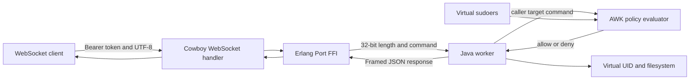

# SUDO-BEAM

A virtual `sudo` command processor written in Java with AWK authorization and an Erlang/OTP WebSocket gateway. A BEAM port provides the foreign-process interface: each WebSocket session owns a JVM worker and its own virtual filesystem. No host sudo, setuid binary, host shell, or JNI library is involved.

## Layers — the sovereign stack on top

The base above is unchanged. Layered on it, under `sovereign/`,
is the sovereign-beam-mojo stack (Elixir 1.20 / OTP 29 control
plane, Mojo 1.2 kernels, Sudo Platform stubs):

| Layer | Where | Role |
| --- | --- | --- |
| Base | `java/`, `awk/`, `beam/`, `tests/` | Virtual sudo: Java worker, AWK policy, Erlang/Cowboy WebSocket gateway |
| Control plane | `sovereign/control/` | Elixir supervision tree, `KernelPort` to the Mojo workers, `Sudo.*` platform stubs |
| Compute | `sovereign/kernels/` | Mojo 1.2: Goldilocks field ops (`field_ops`) and pure-Mojo SHA-256 verifier (`holo_verify`) |
| Bridge | `sovereign/control/lib/sudo/beam_session.ex` | `Sudo.BeamSession`: Elixir GenServer driving the Java worker over a Port with `{packet, 4}` — the same framing as `sudo_beam_ffi`, so the Elixir layer can run a virtual sudo session directly, no WebSocket or Docker needed |
| Verification | `sovereign/receipts/`, `receipts/` | SHA-256 receipts; the live session transcript is verified by `holo_verify` |

Run everything, base plus sovereign layer, with one command:

```sh
bash run_all.sh
```

It runs `make test` (Java/AWK), the sovereign pipeline (Mojo build,
`mix compile`, KernelPort self-test), a live `BeamSession`
round-trip (`whoami`, `sudo id`, `sudo -l`, a write/cat round-trip,
plus a guest denial) with the transcript verified by `holo_verify`,
and emits `receipts/SHA256SUMS` over the whole combined tree. A step
whose toolchain is missing is skipped with a clear line, never
faked as a pass. The Erlang/Cowboy WebSocket path still runs only
in the container (`docker compose up --build`); it is not exercised
on a bare host.

## Architecture



| Layer | Implementation | Role |
| --- | --- | --- |
| Transport | Cowboy 2.12 / WebSocket | Authenticated session and text frames |
| FFI | Erlang `open_port` with `{packet,4}` | JVM lifecycle and framed IPC |
| Runtime | Java 17+ | Parsing, virtual identities, command dispatch |
| Policy | POSIX AWK | Exact caller/target/command authorization |
| State | Java ordered map | Per-session virtual filesystem |
| Packaging | Docker Compose | Non-root worker container, localhost port |

## Quick start without BEAM

Requires JDK 17 or newer, POSIX AWK at `/usr/bin/awk`, and GNU Make. Tests are Java (JDK standard library only).

```sh
make test
java -jar build/sudo.jar operator awk/policy.awk awk/sudoers cli 'sudo id'
java -jar build/sudo.jar guest awk/policy.awk awk/sudoers cli 'sudo id'
```

The first command invocation prints `uid=0(root) gid=0(root) [virtual]`; the second is denied. CLI invocations have fresh state. The persistent port mode retains state until stdin closes.

## BEAM container

Requires Docker with Compose. Set a private token of at least 16 characters. For example, on a local development machine:

```sh
export SUDO_BEAM_TOKEN="$(openssl rand -hex 32)"
docker compose up --build
```

Connect from another terminal with the same token in its environment using a WebSocket client such as websocat:

```sh
websocat -H="Authorization: Bearer $SUDO_BEAM_TOKEN" ws://127.0.0.1:8080/sudo
```

Send one command and wait for its response before sending the next command. Example session:

```text
whoami
sudo id
sudo -u service whoami
sudo -l
mkdir work
write work/report "hello from BEAM"
cat work/report
sudo cat /root/notes
```

Example response for `sudo id`:

```json
{"exit":0,"stdout":"uid=0(root) gid=0(root) [virtual]\n","stderr":""}
```

The configured token maps to the single virtual principal in `SUDO_BEAM_CALLER` (default `operator`). To test an unauthorized principal, set `SUDO_BEAM_CALLER=guest` and recreate the container. The HTTP upgrade requires the authorization header, so a native browser WebSocket constructor cannot connect directly without a separate authentication mechanism. The endpoint uses plaintext WS bound to host loopback, not public TLS termination.

## Command reference

| Command | Meaning |
| --- | --- |
| `id` | Print virtual UID and GID |
| `whoami` | Print effective virtual username |
| `pwd` | Print effective user's virtual home |
| `ls [PATH]` | List visible files and directories |
| `cat PATH` | Read a virtual file |
| `mkdir PATH` | Create a directory |
| `touch PATH` | Create an empty file or leave an existing file unchanged |
| `write PATH TEXT` | Write or replace virtual file data |
| `echo TEXT ...` | Print arguments as text |
| `sudo -l` | List allowed commands for virtual root |
| `sudo -u USER -l` | List allowed commands for target user |
| `sudo [-u USER] [--] COMMAND [ARGS]` | Apply policy then dispatch as target |

`root=0`, `operator=1000`, `guest=1001`, `service=1002`. Effective identity lasts one request. Absolute paths and normalized relative paths refer solely to the virtual filesystem. Non-root users may write only to owned nodes and cannot access other users' private home trees. Files under `/etc` are readable, but writable only by virtual root. There are no shell pipelines, substitutions, symlinks, environment assignments, actual OS authentication, or arbitrary process dispatch. This is a deliberately scoped emulator, not a drop-in replacement for Linux sudo.

## AWK authorization

Rules are four whitespace-delimited columns:

```text
operator root id allow
operator root write allow
operator service whoami allow
```

The last exact match wins. Missing rules, malformed policy records, AWK process failure and timeout deny the request. AWK sees only validated caller, target and command names, not command arguments. The policy is evaluated for every elevated command. There are no wildcard rules or sudoers syntax compatibility claims.

## Erlang foreign-process interface

`sudo_beam_ffi:open/1` starts the JVM with `open_port({spawn_executable, Java}, ...)`. The handler owns the port; port messages arrive in the handler mailbox. `send/2` submits a bounded binary using `port_command`, and `close/1` closes the worker. This is an Erlang Port FFI (out-of-process), not an in-process native NIF.

| Wire direction | Layout |
| --- | --- |
| BEAM to JVM | 4-byte unsigned big-endian length + UTF-8 command |
| JVM to BEAM | 4-byte unsigned big-endian length + UTF-8 JSON response |
| WebSocket client to BEAM | One UTF-8 text frame per command |
| BEAM to WebSocket client | One JSON text frame per result |

The port layer automatically adds/removes the packet header. The Java worker explicitly reads/writes it. Standard output is reserved for framed responses in port mode. Exit codes: `0` success, `1` permission/operation failure, `2` invalid syntax, `127` unknown non-elevated command.

One in-flight request per connection, 16 KiB command limit, 256 virtual filesystem nodes, 4 KiB per file, and 15-second gateway response timeout. The Compose service sets container resource limits. Session state is discarded when the worker closes.

## Verification

`make test` compiles with `javac --release 17 -Xlint:all -Werror` and runs ten automated Java/AWK and framed IPC tests, covering identity, policy, filesystem, isolation, guest behavior, literal metacharacters, malformed policies, rule ordering, Unicode, and size limits.

Authoring environment result: **10/10 tests passed** with OpenJDK 21 and mawk. Erlang, Cowboy and Docker were not available in that environment; `make beam`, the Docker build and the live WebSocket path have not been run there. The following command is a manual end-to-end check once the container is running:

```sh
make smoke  # needs SUDO_BEAM_TOKEN and the gateway running
```

## Repository layout

```text
sudo-beam/
├── awk/
│   ├── policy.awk
│   └── sudoers
├── beam/
│   ├── rebar.config
│   └── src/
│       ├── sudo_beam.app.src
│       ├── sudo_beam_app.erl
│       ├── sudo_beam_ffi.erl
│       ├── sudo_beam_sup.erl
│       └── sudo_beam_ws.erl
├── java/src/SudoEmulator.java
├── tests/
│   ├── SudoEmulatorTest.java
│   └── WsSmoke.java
├── Dockerfile
├── compose.yaml
└── Makefile
```
